# Mini NPU 시뮬레이터 구현 가이드 🎓

## 📚 목차
1. [이 프로젝트가 뭔가요?](#1-이-프로젝트가-뭔가요)
2. [핵심 개념 3가지](#2-핵심-개념-3가지)
3. [파일 구조](#3-파일-구조)
4. [STEP별 코드 설명](#4-step별-코드-설명)
5. [data.json 읽는 법](#5-datajson-읽는-법)
6. [전체 흐름 한눈에 보기](#6-전체-흐름-한눈에-보기)
7. [자주 하는 실수](#7-자주-하는-실수)
8. [테스트 체크리스트](#8-테스트-체크리스트)
9. [결과 리포트](#9-결과-리포트)

---

## 1. 이 프로젝트가 뭔가요?

### 🤔 한 줄 요약
> **그림이 십자가(+) 모양인지, X 모양인지 판별하는 프로그램**

### 🧠 AI가 그림을 인식하는 원리

AI가 그림을 인식할 때 **"필터"** 라는 도구를 사용합니다.

```
입력 패턴 (내가 그린 그림)        필터 (정답 모양 틀)

┌───────────────────┐         ┌───────────────────┐
│  0  0  1  0  0    │         │  0  0  1  0  0    │
│  0  0  1  0  0    │   VS    │  0  0  1  0  0    │
│  1  1  1  1  1    │         │  1  1  1  1  1    │
│  0  0  1  0  0    │         │  0  0  1  0  0    │
│  0  0  1  0  0    │         │  0  0  1  0  0    │
└───────────────────┘         └───────────────────┘
      내 그림                      Cross 필터
```

> 같은 위치의 숫자를 곱해서 더하면 → **점수**가 나옵니다  
> 점수가 높을수록 **"더 비슷하다"** 는 뜻입니다!

---

---
## 2. 핵심 개념 3가지

### 개념 1️⃣ : MAC 연산이란?
컴퓨터는 이미지를 숫자 배열로만 이해합니다. 입력 패턴과 필터(기준 패턴)가 얼마나 유사한지 판단하는 핵심 원리가 바로 **MAC(Multiply-Accumulate) 연산**입니다.

* **MAC = Multiply(곱하기) + Accumulate(누적 더하기)**
* **Multiply (곱하기)**: 두 행렬의 같은 위치에 있는 숫자끼리 곱합니다.
* **Accumulate (더하기/누적)**: 곱한 결과들을 모두 하나로 합쳐 최종 점수를 산출합니다.

> 쉽게 말하면: **"같은 위치끼리 곱하고, 다 더한다"**

```
필터:            입력:            곱하기 결과:
┌───────────┐   ┌───────────┐   ┌────────────────────┐
│  0  0  1  │   │  0  0  1  │   │  0×0   0×0   1×1   │
│  0  1  0  │ × │  0  1  0  │ = │  0×0   1×1   0×0   │
│  1  0  0  │   │  1  0  0  │   │  1×1   0×0   0×0   │
└───────────┘   └───────────┘   └────────────────────┘

최종 합계: 0+0+1 + 0+1+0 + 1+0+0 = 3.0  ← 이게 MAC 점수!
```

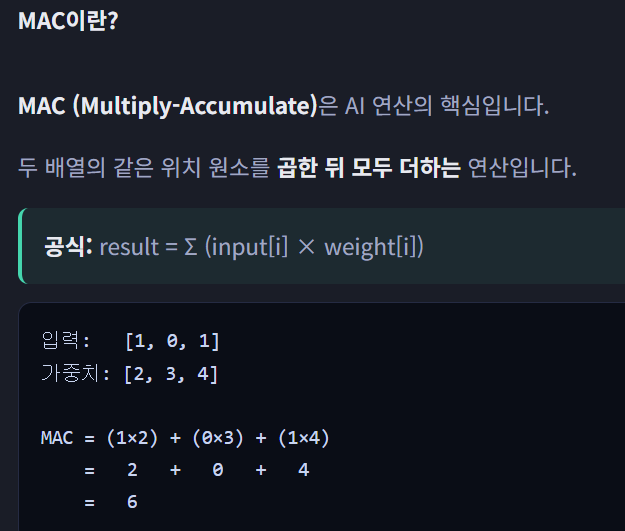
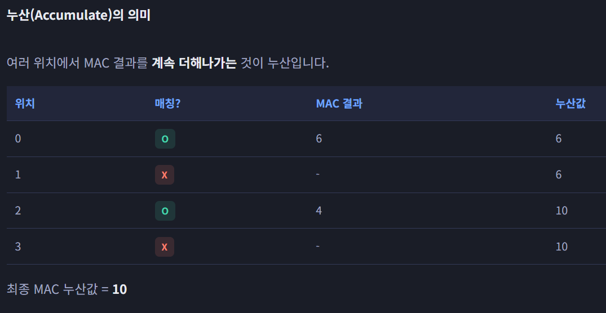

### 개념 2️⃣ : 왜 필터가 필요한가?

```
Cross 필터로 계산  →  Cross 점수: 9.0   ← 높다!
X     필터로 계산  →  X     점수: 1.0   ← 낮다!

9.0 > 1.0  →  "이 그림은 Cross 입니다!" ✅
```

* 필터는 **"이 모양이 맞으면 점수를 높게 주는 채점표"** 입니다.
* 필터는 입력 이미지에서 특정 특징이 얼마나 잘 나타나는지 점수로 계산합니다.
* 점수가 높을수록 해당 필터가 찾는 특징과 비슷하다는 뜻입니다.
* 다만 실제 CNN에서는 점수가 반드시 0~9 사이인 것은 아니고, 필터의 숫자와 
  입력 이미지에 따라 다양한 값이 나옵니다.

* 필터(Filter)는 입력 데이터에서 찾고자 하는 패턴의 템플릿입니다.
* 입력 벡터를 왼쪽에서 오른쪽으로 슬라이딩하며 필터와 비교합니다.
* 비유: 필터는 "도장"이고, 입력은 "종이"입니다. 도장을 찍어서 일치하는 
       위치를 찾는 것입니다.

---

---
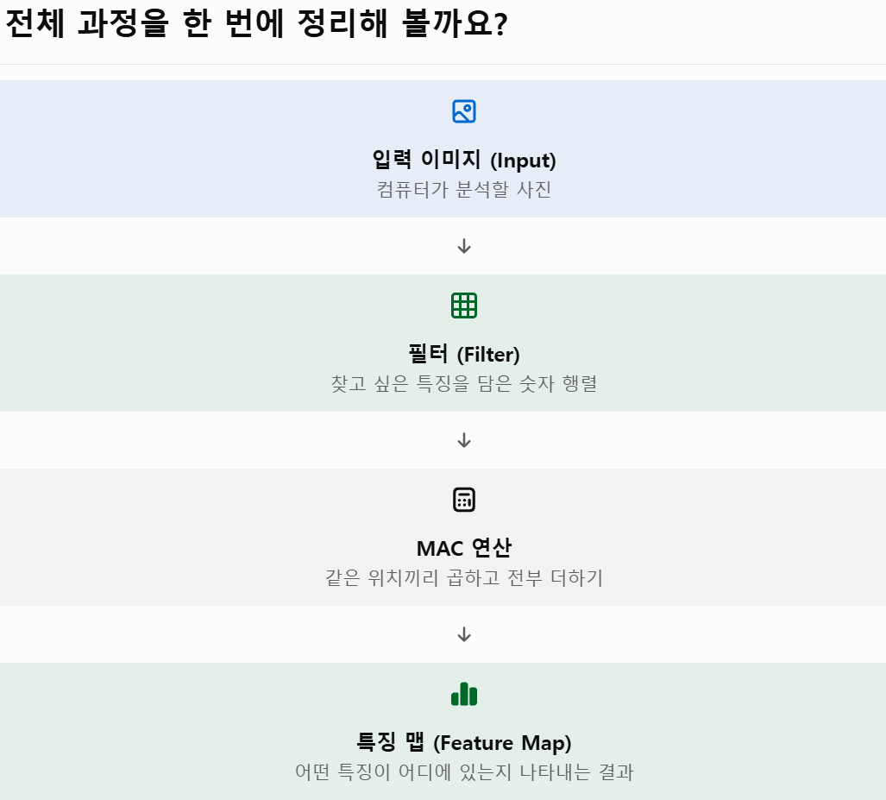


### 개념 3️⃣ : 라벨 정규화란?

JSON 파일에는 `"+"`, `"x"` 처럼 다양하게 쓰여 있습니다.  
프로그램 안에서는 **통일된 이름**을 써야 합니다.
정규화는 쉽게 말해서 서로 다른 표현을 하나의 약속된 표현으로 통일하는 것

정규화 = 여러 가지 표현을 하나의 통일된 표현으로 바꾸는 작업

```
JSON에 있는 값    →    프로그램 안에서 쓰는 값
─────────────────────────────────────────────
    "+"          →         "Cross"
  "cross"        →         "Cross"
    "x"          →           "X"
    "X"          →           "X"
```

```

## 🔄 데이터 정규화 및 매핑 과정

프로그램 외부(JSON 파일, DB, 사용자 입력 등)에서 들어오는 데이터는 형식이 제각각인 경우가 많습니다. 프로그램 내부 로직이 복잡해지는 것을 막고 일관성을 유지하기 위해, 이 다양한 값들을 약속된 하나의 표준 값으로 통일합니다.

### 📋 라벨 매핑 규칙

| 입력 형태 (외부 데이터)           | 정규화된 내부 표준 값 | 설명 |
| `+`, `cross`, `Cross`, `CROSS` | **`Cross`**        | 외부에서 어떤 형태로 들어오든 첫 글자가 대문자인 `Cross`로 통일하여 인식합니다. |
| `x`, `X`                       | **`X`**            | 소문자 `x`와 대문자 `X`를 모두 대문자 `X` 하나로 통일합니다. |

> **💡 핵심 포인트**
> 외부의 다양한 표기 방식을 내부 로직에서 공통된 기준(`Cross`, `X`)으로 처리할 수 있도록 매핑해 주는 핵심 전처리 과정입니다.
```

```
* 정규화 장점
1. 데이터가 서로 다른 표현으로 들어와도 처리하기 쉽습니다.
2. 프로그램이 데이터를 잘못 판단할 가능성을 줄입니다.
3. 비교하거나 분류하는 작업이 간단해집니다.
4. 프로그램 내부의 코드가 복잡해지는 것을 방지합니다.
```
---

## 3. 파일 구조

```
mini_npu/
│
├── main.py              ← 프로그램 시작점 (여기서 실행! : "python3 main.py")
├── data_structure.py    ← Pattern 클래스 (데이터 저장 방식)
├── mac.py               ← MAC 연산 함수
├── judge.py             ← 점수 비교 → 판정
├── input_handler.py     ← 사용자 입력 처리
├── json_loader.py       ← data.json 읽기
├── performance.py       ← 실행 시간 측정
└── data.json            ← 테스트 데이터
```
> 💡 **파일 작성 순서:**
> `data_structure` → `mac` → `judge` → `input_handler` → `json_loader` → `performance` → `main`

---

---
## 4. STEP별 코드 설명

---

### STEP 1: `data_structure.py` - 데이터 저장 방식

#### 🤔 왜 이게 필요한가요?

5×5 행렬을 저장할 때 2D 리스트를 쓰면 편하지만,  
실제 NPU 하드웨어는 **1D(일렬)로 메모리에 저장**합니다.  
이 클래스는 그 방식을 흉내냅니다.
2차원(2D)으로 된 데이터를 1차원(1D)으로 펼쳐서 저장하는 방법

#### 📐 2D → 1D 변환 원리
컴퓨터의 메모리(RAM)는 물리적으로 **직선 형태(1차원)**로 늘어서 있습니다. 그래서 우리가 이미지(2D)를 저장할 때, 첫 번째 줄을 먼저 적고, 그 뒤에 바로 두 번째 줄을 이어 붙이는 방식을 사용

```
2D 행렬:              1D 리스트 (실제 저장):

┌───────────┐
│  1  2  3  │   →   [ 1, 2, 3, 4, 5, 6, 7, 8, 9 ]
│  4  5  6  │         └─row0─┘ └─row1─┘ └─row2─┘
│  7  8  9  │
└───────────┘

위치 계산 공식: index = row × n + col
예) row=1, n=3, col=2 →  index = 1×3+2 = 5  →  값: 6

```
 ## 🗺️ 2차원 행렬과 1차원 리스트의 주소 변환 (가장 중요한 공식 : `index = row * n + col`)

2D 행렬은 사람이 보기 편한 구조이고, 1D 리스트는 컴퓨터가 메모리에 저장하기 편한 구조입니다. 
`row * n + col` 공식은 **2차원 지도를 보고 1차원 주소를 찾아가는 내비게이션**과 같습니다.

### 📌 주요 용어 정의
* **`row`**: 찾으려는 값이 몇 번째 줄(행)에 있는가? *(0부터 시작)*
* **`n`**: 한 줄에 데이터가 몇 개 있는가? *(가로 너비)*
* **`col`**: 그 줄에서 몇 번째 칸(열)에 있는가? *(0부터 시작)*
* **`index`**: 1D(1차원) 배열에서의 최종 위치 번호


#### 💻 코드

```python
# data_structure.py

```
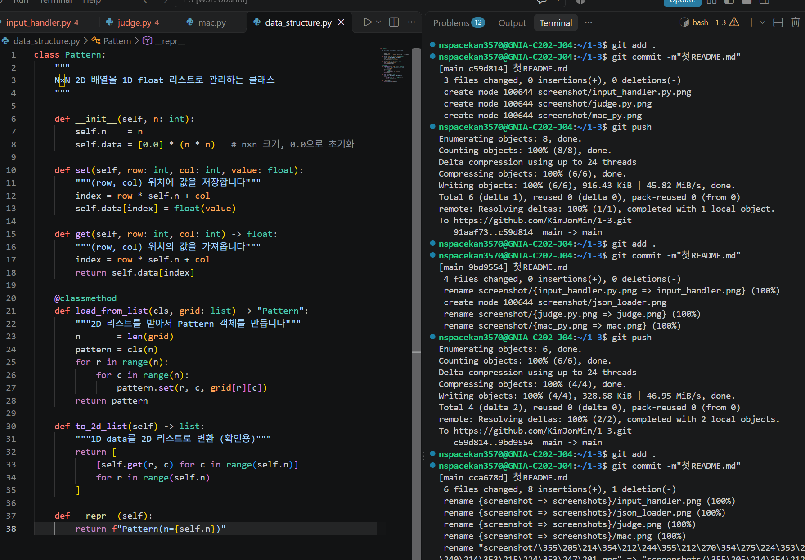

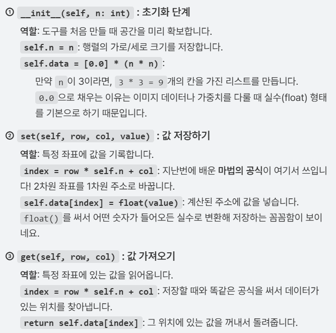

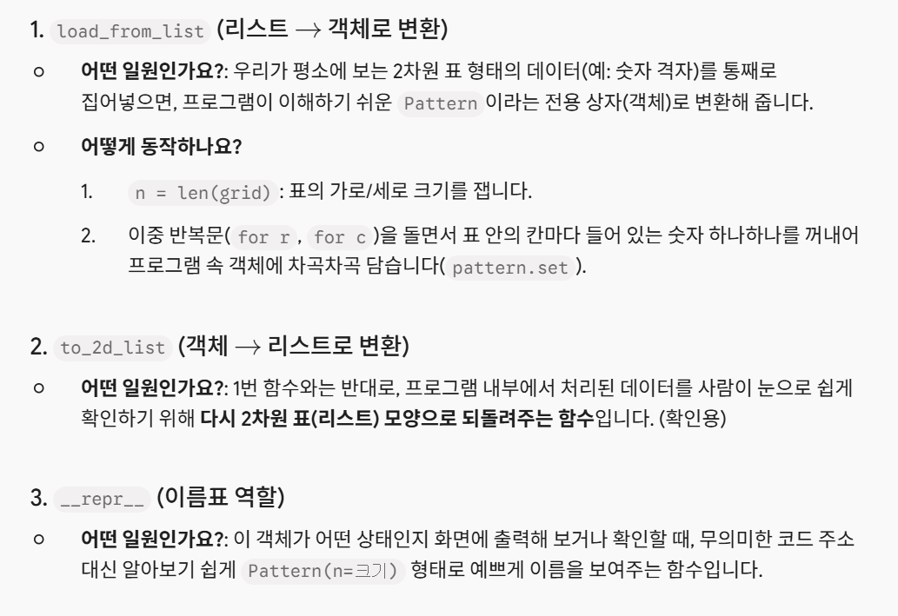

```

```
#### ✅ 테스트 해보기

p = Pattern(3)         # 3x3 크기의 패턴 객체 생성
p.set(0, 0, 1.0)       # (0행, 0열)에 1.0 저장
p.set(1, 1, 1.0)       # (1행, 1열)에 1.0 저장

print(p.get(0, 0))     # 출력: 1.0 (값 조회)
print(p.get(0, 1))     # 출력: 0.0 (기본값)

print(p.to_2d_list())  # 전체 데이터를 2차원 표 형태로 출력
# 출력 결과:
# [[1.0, 0.0, 0.0],
#  [0.0, 1.0, 0.0],
#  [0.0, 0.0, 0.0]]
```

```
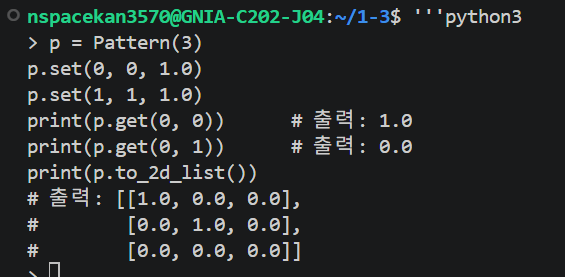

---

### STEP 2: `mac.py` - 핵심 연산
---

#### 🤔 이 함수가 하는 일

```
filter의 각 위치 값  ×  input의 같은 위치 값  →  전부 더하기  →  점수
```

#### 손으로 계산해서 확인하기

```
Cross 필터 (5×5):              Cross 패턴 입력:
┌─────────────────────────┐    ┌─────────────────────────┐
│  0    0    1    0    0  │    │  0    0    1    0    0  │
│  0    0    1    0    0  │    │  0    0    1    0    0  │
│  1    1   0.9   1    1  │  × │  1    1    1    1    1  │
│  0    0    1    0    0  │    │  0    0    1    0    0  │
│  0    0    1    0    0  │    │  0    0    1    0    0  │
└─────────────────────────┘    └─────────────────────────┘

0이 아닌 곱만 표시:
  (0,2): 1 × 1 = 1.0
  (1,2): 1 × 1 = 1.0
  (2,0): 1 × 1 = 1.0
  (2,1): 1 × 1 = 1.0
  (2,2): 0.9 × 1 = 0.9   ← 중심은 0.9!
  (2,3): 1 × 1 = 1.0
  (2,4): 1 × 1 = 1.0
  (3,2): 1 × 1 = 1.0
  (4,2): 1 × 1 = 1.0

합계 = 8.9  ← Cross 점수
```

#### 💻 코드

```python
# mac.py

```
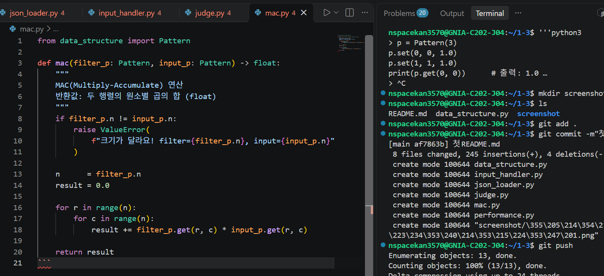
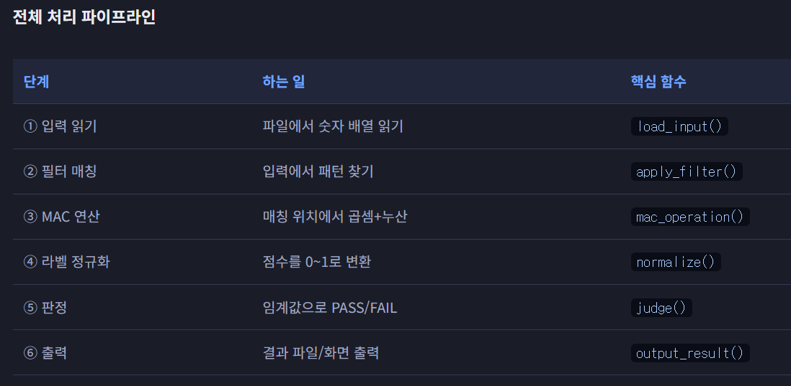
```
## 🧮 MAC 연산 함수 상세 분석 (`mac.py`)

### 📌 코드 단계별 뜯어보기

1. **안전장치**
   * **코드**: `if filter_p.n != input_p.n:`
   * **역할**: 연산하려는 두 패턴(필터와 입력)의 크기(가로세로 칸 수)가 다르면 에러(`ValueError`)를 발생시켜 프로그램이 이상한 값을 계산하지 않도록 미리 방어합니다. *(예: $3 \times 3$ 필터와 $5 \times 5$ 입력은 계산 불가)*

2. **초기화 (13~14번 줄)**
   * **`n = filter_p.n`**: 격자의 크기(예: `3`)를 변수에 담습니다.
   * **`result = 0.0`**: 계산된 최종 점수를 담아둘 바구니(`result`)를 `0.0`으로 깨끗하게 비워둡니다.

3. **이중 반복문과 MAC 연산**
   * **반복문 (`for r in range(n): / for c in range(n):`)**: 표의 맨 위 왼쪽부터 맨 아래 오른쪽까지 모든 칸(행 `r`, 열 `c`)을 빠짐없이 하나씩 방문합니다.
   * **`result += filter_p.get(r, c) * input_p.get(r, c)`**:
     * **Multiply (곱하기)**: 필터의 특정 칸 숫자와 입력의 똑같은 위치 칸 숫자를 서로 곱합니다.
     * **Accumulate (누적 더하기)**: 그 곱한 값들을 `result` 바구니에 차곡차곡 더해서 쌓습니다(`+=`).

4. **결과 반환**
   * **코드**: `return result`
   * **역할**


### `calculate_score` 함수 동작 순서
* **`def calculate_score(...)`**: 점수 계산 함수를 선언합니다.
* **`score = 0`**: 점수의 초기값을 `0`으로 설정합니다.
* **`for i in range(5)`**: `0`부터 `4`까지 5개의 행을 반복합니다.
* **`for j in range(5)`**: 각 행에서 `0`부터 `4`까지 5개의 열을 반복합니다.
* **`filter[i][j]`**: 필터의 해당 위치 숫자를 가져옵니다.
* **`input[i][j]`**: 입력 배열의 해당 위치 숫자를 가져옵니다.
* **`*`**: 두 숫자를 서로 곱합니다.
* **`score +=`**: 곱한 결과를 기존 점수에 누적합니다.
* **`return score`**: 최종 계산된 점수를 반환합니다.

### 🔄 반복문의 마법: 2중 For문
* **`r (row)`**: 행(줄)을 하나씩 아래로 내려갑니다.
* **`c (col)`**: 각 줄 안에서 칸을 하나씩 옆으로 이동합니다.
* **`filter_p.get(r, c) * input_p.get(r, c)`**: 
  필터의 특정 위치 값과 이미지(`input`)의 똑같은 위치 값을 곱합니다. 이전에 만든 `get` 메서드를 사용해 내부적으로는 1D 리스트의 위치를 정확히 찾아가고 있습니다.
* **`result +=`**: 곱한 값들을 `result`라는 바구니에 차곡차곡 더해서 쌓습니다.
---

### 🛡️ 안전장치: 크기 검사
* **이유**: MAC 연산은 두 행렬의 칸 수가 완벽하게 일치해야 합니다. *(예: 3x3 필터는 3x3 영역과만 계산 가능)*
* **역할**: 크기가 다른 데이터를 넣었을 때 프로그램이 이상한 값을 내놓지 않도록 미리 에러를 발생시켜 방어합니다.
---

### 📊 Cross 필터와 실제 이미지 매칭 결과
* **모양이 비슷하면?** `result` 값이 커집니다. *(특징 발견!)*
* **모양이 다르면?** `result` 값이 작아집니다. *(특징 없음!)*


---

### STEP 3: `judge.py` - 판정

파일의 역할인 '최종 판정 로직'**을 설명하는 부분
두 후보의 점수를 비교해서 승자를 결정하는 심판 역할

#### 🤔 판정 흐름

```
Cross 점수  vs  X 점수
─────────────────────────────────────────

Cross 점수 > X 점수   →   결과: "Cross"
Cross 점수 < X 점수   →   결과: "X"
Cross 점수 = X 점수   →   결과: "UNDECIDED"

```
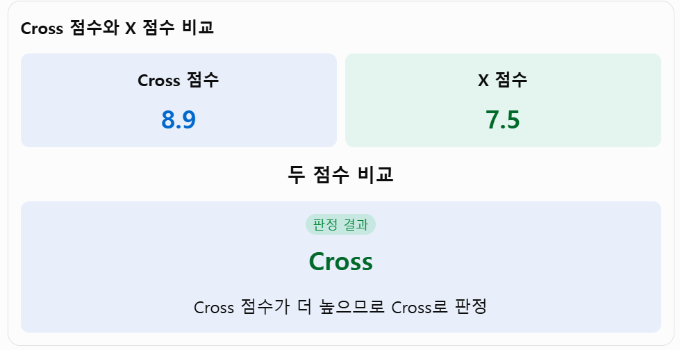

```

#### 💻 코드

```python
# judge.py

```
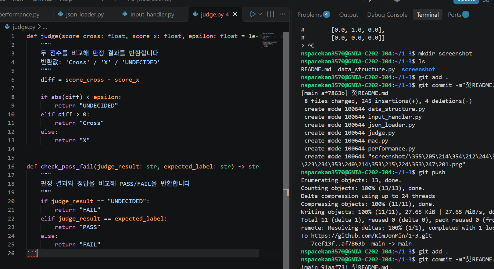


## ⚖️ 판정 함수(`judge`) 주요 문법 및 용어 정리
* **`def`**: 함수를 정의하는 파이썬 명령어
* **`judge`**: 함수 이름
* **`cross_score`**: Cross 점수를 전달받는 변수
* **`x_score`**: X 점수를 전달받는 변수
* **`=`**: 값을 저장하는 대입 연산자
* **`==`**: 두 값이 같은지 비교하는 연산자
* **`>` / `<`**: 크고 작은지 비교하는 비교 연산자


#### ✅ 판정 예시

```
예시 1)  Cross 패턴 입력
  Cross 점수 : 8.9
  X     점수 : 0.0
  judge()    : "Cross"
  정답       : "Cross"
  결과       : PASS ✅

예시 2)  애매한 패턴 입력
  Cross 점수 : 3.0
  X     점수 : 3.
```


--- 

### STEP 4: `input_handler.py` - 사용자 입력

#### 🤔 이 함수가 하는 일

```
사용자가 잘못 입력해도 프로그램이 죽지 않고
"다시 입력하세요" 라고 안내합니다.
```

#### 입력 검증 흐름

```
사용자 입력
     │
     ▼
숫자인가? ──── NO ──→ "숫자를 입력하세요" → 다시 입력
     │
    YES
     │
     ▼
유효한 크기인가? ── NO ──→ "5, 13, 25 중 하나를 입력하세요" → 다시 입력
     │
    YES
     │
     ▼
입력 완료!
```

#### 💻 코드

```python
# input_handler.py

```
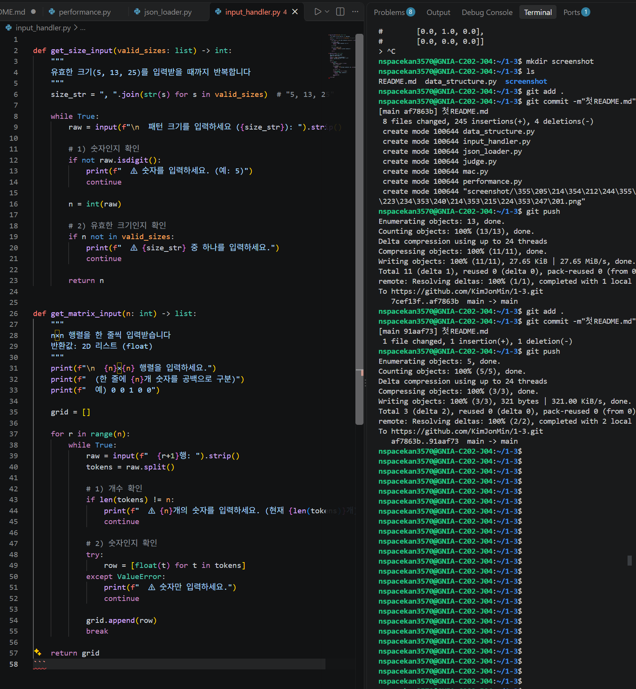
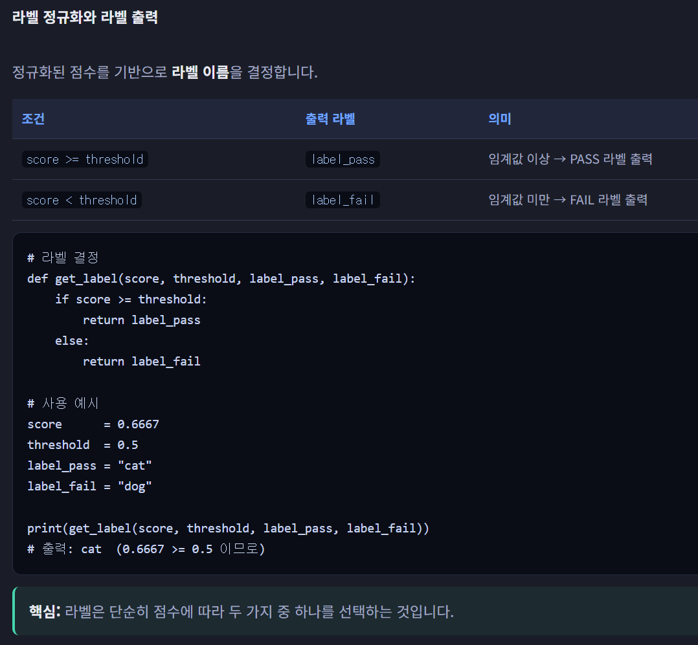
```

### 1. `get_size_input(valid_sizes)`
사용자로부터 유효한 패턴 크기(예: `5, 13, 25`)를 올바르게 입력받을 때까지 반복 확인하는 함수입니다.
* **안내 문자열 생성**: 전달받은 리스트를 `5, 13, 25` 형태의 문자열로 변환합니다.
* **무한 루프 (`while True`)**: 올바른 값이 입력될 때까지 입력을 요구합니다.
* **숫자 확인 (`isdigit`)**: 입력값이 숫자인지 검사하고, 아니면 재입력을 요청합니다.
* **유효성 검사**: 정수로 변환한 값이 허용된 목록(`valid_sizes`)에 포함되는지 확인 후 통과한 정수 `n`을 반환합니다.

### 2. `get_matrix_input(n)`
$n \times n$ 크기의 행렬 데이터를 사용자로부터 한 줄씩 입력받아 2차원 리스트(`float`)로 반환하는 함수입니다.
* **행 반복**: 총 $n$개의 행을 각각 입력받기 위해 반복문을 실행합니다.
* **공백 분리 (`split`)**: 입력된 문자열을 공백 기준으로 쪼개 토큰 리스트를 만듭니다.
* **1) 개수 확인**: 입력된 숫자의 개수(`len(tokens)`)가 행렬 크기 `n`과 일치하는지 검사합니다.
* **2) 숫자 변환 및 예외 처리 (`try-except`)**: 
  * 모든 토큰을 실수(`float`)로 변환을 시도합니다.
  * 문자가 섞여 `ValueError`가 발생하면 `"△ 숫자만 입력하세요."`를 출력하고 재입력을 받습니다.

```

#### ✅ 입력 예시

패턴 크기를 입력하세요 (5, 13, 25): abc
  ⚠ 숫자를 입력하세요. (예: 5)

패턴 크기를 입력하세요 (5, 13, 25): 7
  ⚠ 5, 13, 25 중 하나를 입력하세요.

패턴 크기를 입력하세요 (5, 13, 25): 5
  ✅ 5 선택됨

5×5 행렬을 입력하세요.
(한 줄에 5개 숫자를 공백으로 구분)
예) 0 0 1 0 0

  1행: 0 0 1 0 0
  2행: 0 0 1 0 0
  3행: 1 1 1 1 1
  4행: 0 0 1 0 0
  5행: 0 0 1 0 0
```

---

### STEP 5: `json_loader.py` - 데이터 로드

#### 🤔 이 함수가 하는 일

```
data.json 파일
      │
      ▼
파일 읽기 (json.load)
      │
      ▼
filters  → 크기별로 Pattern 객체 2개 생성 (Cross, X)
patterns → 패턴마다 Pattern 객체 + expected 라벨 생성
      │
      ▼
딕셔너리로 반환
```

#### 💻 코드

```python
# json_loader.py

```
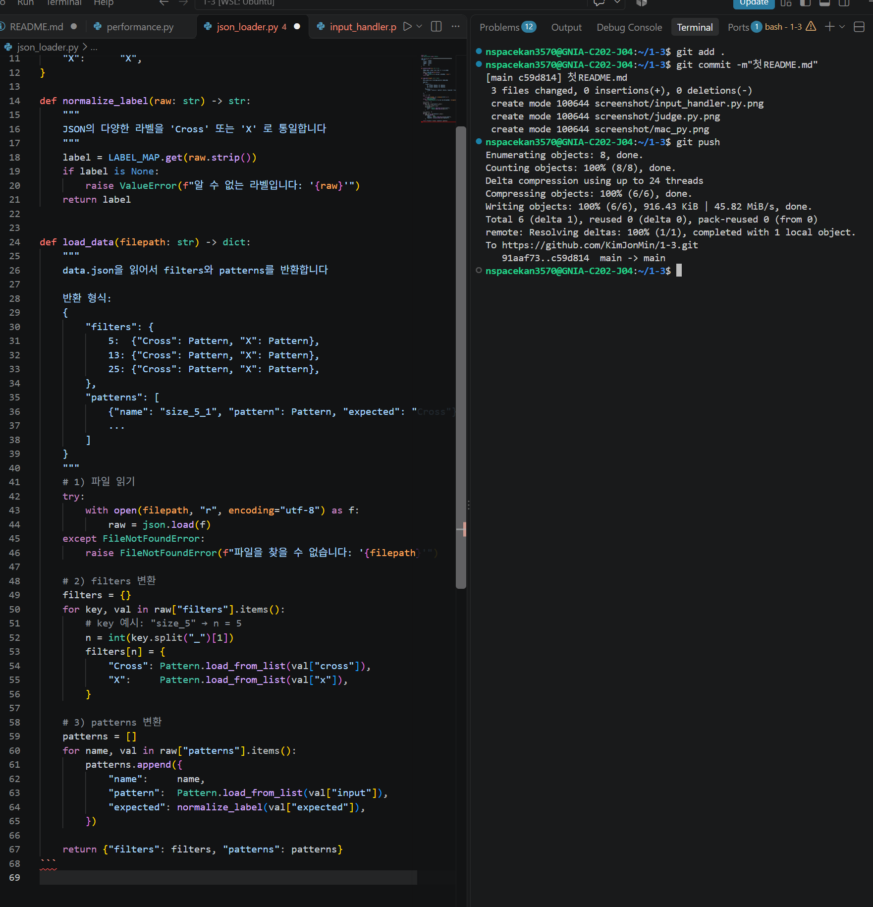

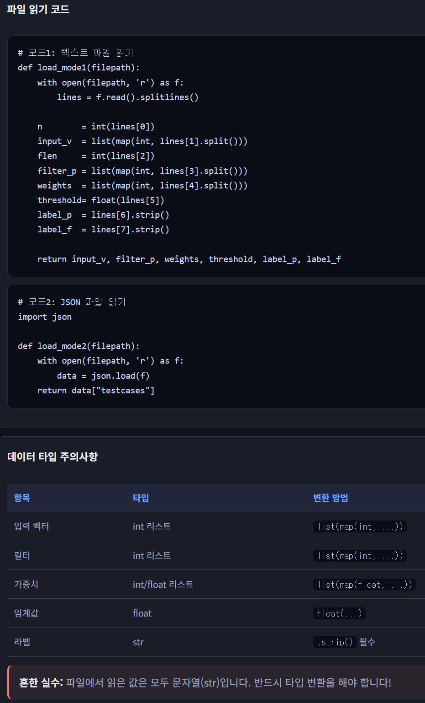
```

### 1. 라벨 정규화 테이블 및 함수 (`LABEL_MAP` & `normalize_label`)
JSON 파일이나 사용자 입력에 따라 제각각 다를 수 있는 라벨 표기를 일관된 형태로 통일합니다.
* **`LABEL_MAP` (딕셔너리)**:
  * `"+", "cross", "Cross", "CROSS"` $\rightarrow$ **`"Cross"`**로 매핑
  * `"x", "X"` $\rightarrow$ **`"X"`**로 매핑
* **`normalize_label(raw: str) -> str`**: 
  * 공백을 제거(`raw.strip()`)한 뒤 표준 라벨을 찾아 반환합니다.
  * 사전에 없는 값이 들어오면 `ValueError`를 발생시켜 잘못된 입력을 차단합니다.

### 2. 데이터 로드 함수 (`load_data`)
지정된 파일 경로(`filepath`)에서 JSON 파일을 읽어 프로그램용 딕셔너리 형태로 변환합니다.
* **1) 파일 읽기 (`try-except`)**: 
  * `open(filepath, "r", encoding="utf-8")`로 UTF-8 인코딩을 적용해 안전하게 불러옵니다.
  * 파일이 없으면 `FileNotFoundError` 예외를 처리하여 에러 메시지를 발생시킵니다.
* **2) 필터(`filters`) 변환**: 
  * 필터 키(예: `"size_5"`)를 `key.split("_")[1]` 방식으로 쪼개어 정수형 크기 `n`(예: `5`)으로 바꿉니다.
  * 각 크기별 리스트 데이터를 `Pattern.load_from_list()`를 통해 `Pattern` 객체로 변환하여 `filters[n]`에 저장합니다.
---

---

### STEP 6: `performance.py` - 성능 측정

#### 🤔 이 함수가 하는 일

```
MAC 연산을 100번 반복 실행
         │
         ▼
총 걸린 시간 ÷ 100
         │
         ▼
평균 실행 시간 (ms) 반환
```

#### 💻 코드

```python
# performance.py

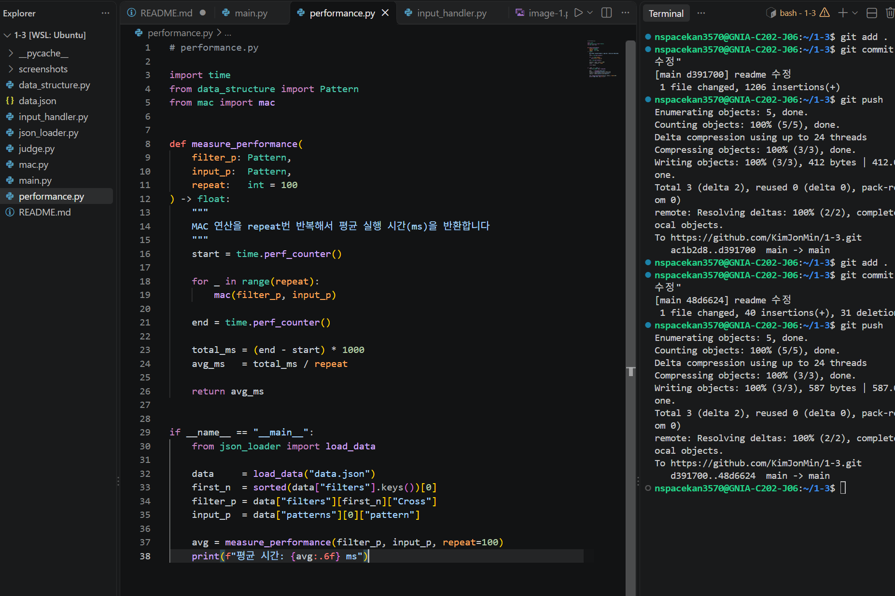
```

MAC 연산의 실행 속도를 반복 측정하여 평균 소요 시간(ms)을 반환하는 함수입니다

### 📌 매개변수 (Parameters)
* **`filter_p`**: 연산에 사용할 필터 패턴 객체
* **`input_p`**: 연산에 사용할 입력 패턴 객체
* **`repeat`**: 성능 측정 정확도를 높이기 위한 반복 횟수 *(기본값: 100회)

---

### 🔄 주요 동작 흐름
1. **시작 시간 기록**: `time.perf_counter()`를 이용해 정밀한 시작 시점(`start`)을 기록합니다
2. **반복 연산 수행**: 지정된 횟수(`repeat`)만큼 `mac(filter_p, input_p)` 연산을 반복 실행합니다
3. **종료 시간 기록**: 연산이 끝난 직후의 시점(`end`)을 기록합니다
4. **단위 변환 및 평균 계산**: 
   * 총 소요 시간(초)에 `1000`을 곱해 밀리초(`ms`, `total_ms`)로 변환합니다
   * 총 시간을 반복 횟수(`repeat`)로 나누어 1회 실행 평균 시간(`avg_ms`)을 구합니다
5. **결과 반환**: 계산된 평균 실행 시간을 실수(`float`) 형태로 반환합니다

---

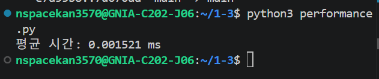

#### ✅ 출력 예시

```
평균 시간: 0.002341 ms
```

---

### STEP 7: `main.py` - 전체 조립

#### 🤔 이 파일이 하는 일

```
모든 모듈을 불러와서
사용자와 대화하며 프로그램을 실행합니다
```

#### 💻 코드

```python
# main.py

```


---

from json_loader    import load_data
from mac            import mac
from judge          import judge, check_pass_fail
from input_handler  import get_size_input, get_matrix_input
from performance    import measure_performance
from data_structure import Pattern

# ── 모드 1: 자동 배치 검사 ──────────────────────────────────

    # 최종 요약
    print("\n" + "=" * 50)
    print(f"  총 {total}개 | ✅ PASS: {passed} | ❌ FAIL: {failed}")
    print("=" * 50)

## ⚙️ 자동 배치 검사 함수 (`run_model1`)
`data.json`에 정의된 모든 패턴을 자동으로 순회하며 MAC 연산을 수행하고, 정답 일치 여부(`PASS`/`FAIL`)를 검사해 최종 통계를 요약해 주는 함수입니다

### 📌 주요 동작 흐름
1. **데이터 준비 및 초기화**
   * `data` 딕셔너리에서 `filters`와 `patterns`를 추출합니다
   * 전체 검사 횟수(`total`), 성공 횟수(`passed`), 실패 횟수(`failed`)를 `0`으로 초기화합니다
2. **패턴 순회 및 MAC 연산**
   * 각 패턴의 이름, 패턴 객체, 정답, 크기(`n`)를 가져옵니다
   * 크기별 `"Cross"`와 `"X"` 필터와 MAC 연산을 수행해 점수를 계산합니다
3. **판정 및 성능 측정**
   * `judge()`로 판정 결과를 내리고, `check_pass_fail()`로 정답과 비교해 `PASS`/`FAIL`을 결정합니다
   * `measure_performance()`로 평균 실행 시간(`avg_ms`)을 측정합니다
4. **결과 출력 및 통계 누적**
   * 패턴별 상세 결과(점수, 판정, 시간 등)를 출력하고 카운트를 누적합니다
5. **최종 요약 출력**
   * 모든 검사 종료 후 **총 검사 개수, PASS 및 FAIL 개수**를 최종 요약해 보여줍니다

---

# ── 모드 2: 수동 입력 검사 ──────────────────────────────────

## 🕹️ 수동 입력 검사 함수 (`run_mode2`)
사용자가 직접 패턴 크기와 행렬 데이터를 입력하면, MAC 연산을 수행하고 판정 및 성능 측정 결과를 보여주는 대화형 모드입니다[cite: 6].

### 📌 주요 동작 흐름
1. **초기 설정**
   * `data` 딕셔너리에서 필터 정보를 가져오고, 사용 가능한 크기 목록(`valid_sizes`)을 정렬하여 준비합니다
2. **무한 루프 (`while True`)**
   * 사용자가 원할 때까지 수동 검사 과정을 반복할 수 있도록 구조화되어 있습니다
3. **1) 크기 선택**: `get_size_input(valid_sizes)`로 유효한 패턴 크기
   (`n`)를 입력받습니다
4. **2) 행렬 입력**: `get_matrix_input(n)`으로 $n \times n$ 행렬 
   데이터를 받아 `Pattern.load_from_list(grid)`로 패턴 객체(`pat`)로 변환합니다
5. **3) MAC 연산**: `"Cross"`와 `"X"` 필터를 불러와 입력 패턴과의 연산 
   점수(`score_cross`, `score_x`)를 각각 계산합니다
6. **4) 판정 및 5) 성능 측정**: `judge()`로 최종 판정 결과를 도출하고, 
  `measure_performance()`로 평균 실행 시간(`avg_ms`)을 측정합니다
7. **6) 결과 출력**: 점수, 판정 결과, 소요 시간을 보기 쉽게 출력합니다
8. **7) 계속 여부 확인**: 재입력 여부(`y/n`)를 확인하여 `"y"`가 아닐 경우 `break`로 함수를 종료합니다

---

# ── 메인 함수 ───────────────────────────────────────────────

## 🚀 메인 함수 및 프로그램 진입점 (`main`)

프로그램의 전체 흐름을 제어하는 컨트롤러이자 실행 진입점입니다

### 1. 프로그램 시작 및 데이터 로드
* **타이틀 출력**: 화면에 `"Mini NPU 시뮬레이터"` 제목을 출력합니다
* **데이터 로드 (`try-except`)**: 
  * `load_data("data.json")`으로 시뮬레이션 데이터를 불러옵니다
  * 파일이 없거나(`FileNotFoundError`) 형식이 잘못된 경우(`ValueError`), 에러 메시지 출력 후 안전하게 종료합니다

---

### 2. 모드 선택 루프 (`while True`)
데이터 로드 성공 시, 사용자가 원하는 작업을 선택할 수 있도록 메뉴를 반복 제공합니다
* **메뉴 구성**:
  1. **`1`번 (자동 배치 검사)**: `data.json`의 전체 패턴을 자동 검사하는 `run_mode1(data)` 실행
  2. **`2`번 (수동 입력 검사)**: 사용자가 직접 입력하여 검사하는 `run_mode2(data)` 실행
  3. **`3`번 (종료)**: 안내 메시지 출력 후 `break`로 프로그램 종료
* **예외 처리 (`else`)**: `1, 2, 3` 외의 값이 입력되면 경고 메시지를 띄워 올바른 입력을 유도합니다

---

### 3. 프로그램 진입점
* **`if __name__ == "__main__":`**: 파일이 직접 실행될 때 `main()` 함수가 자동으로 호출되도록 설정하는 표준 진입점입니다

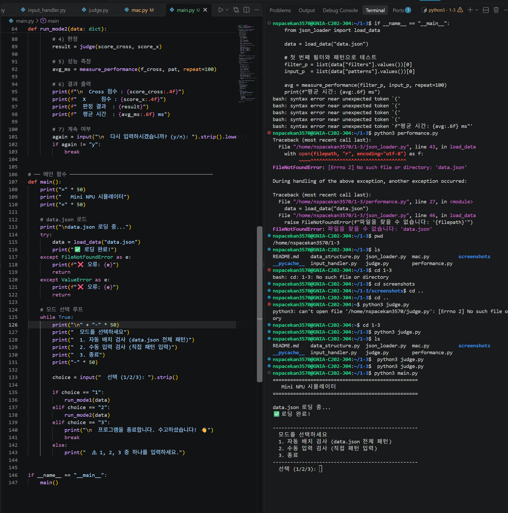

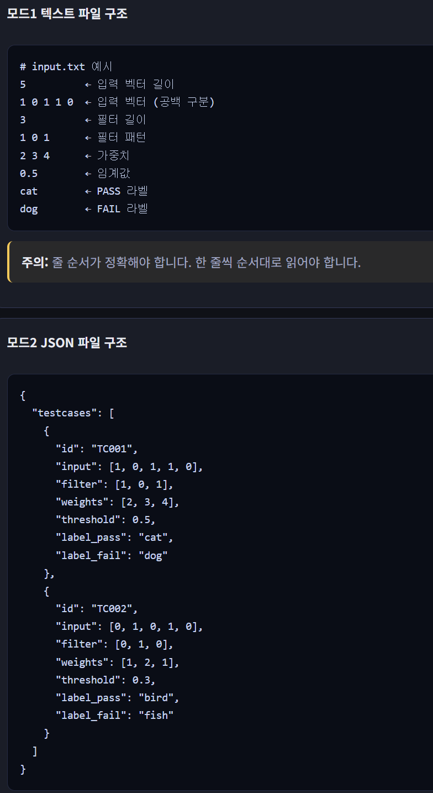

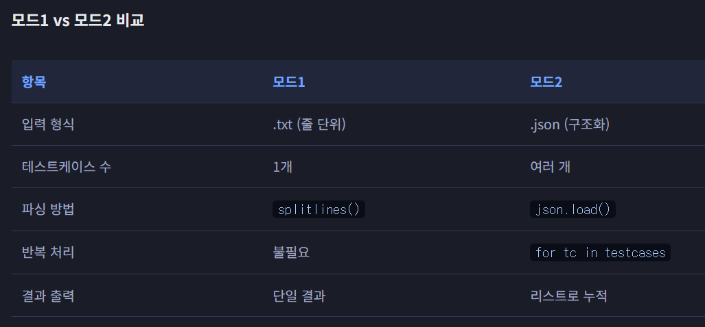

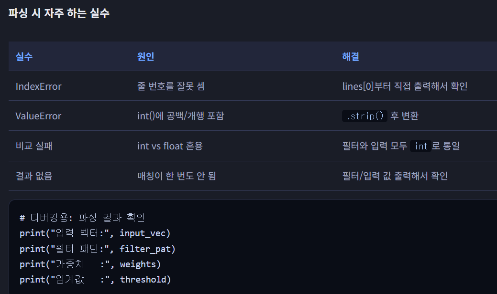

---

## 🏷️ 라벨 정규화 함수 분리 (`normalize_label`)

라벨 정규화 로직을 별도 함수로 분리한 이유와 장점입니다.

### 📌 분리한 이유 및 장점
* **코드 재사용성**: 정규화 규칙이 필터 키 로드와 정답(`expected`) 검증 등 여러 곳에서 동일하게 사용됩니다.
* **유지보수 용이성**: 규칙이 변경될 때 함수 내부 한 곳만 수정하면 되므로 관리하기 편리합니다.
* **일관된 예외 처리**: 각 호출부에서 `try-except ValueError`를 통해 정규화 실패 상황을 일관되게 방어하고 처리할 수 있습니다.


## 5. data.json 읽는 법

### 📄 JSON 구조와 코드 연결

```
data.json 구조                     파이썬에서 접근하는 방법
─────────────────────────────────────────────────────────
{
  "filters": {
    "size_5": {               →   filters[5]
      "cross": [[...], ...]   →   filters[5]["Cross"]  (Pattern 객체)
      "x":     [[...], ...]   →   filters[5]["X"]      (Pattern 객체)
    },
    "size_13": { ... }        →   filters[13]
    "size_25": { ... }        →   filters[25]
  },
  "patterns": {
    "size_5_1": {               →   patterns[0]
      "input":    [[...], ...]  →   patterns[0]["pattern"]  (Pattern 객체)
      "expected": "+"           →   patterns[0]["expected"] → "Cross"
    },
    "size_5_2": { ... }         →   patterns[1]
  }
}
```

### 📌 자주 헷갈리는 부분

```
❌ 틀린 접근:  raw["filters"]["5"]        ← 문자열 "5" 로 접근하면 KeyError!
✅ 올바른 접근: raw["filters"]["size_5"]  ← JSON 키는 "size_5" 형태

❌ 틀린 접근:  filters["size_5"]          ← 변환 후에는 정수 키!
✅ 올바른 접근: filters[5]               ← 변환 후에는 정수 5 로 접근
```

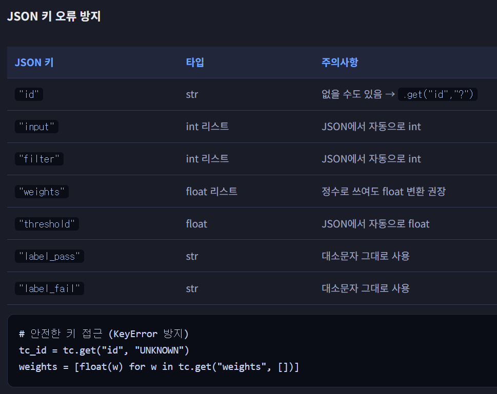

---


## 6. 전체 흐름 한눈에 보기

```
프로그램 시작 (main.py)
        │
        ▼
data.json 로드 (json_loader.py)
        │
        ├── filters  → {5: {Cross: Pattern, X: Pattern}, ...}
        └── patterns → [{name, pattern, expected}, ...]
        │
        ▼
모드 선택
        │
        ├── 모드 1: 자동 배치 검사
        │       │
        │       ▼
        │   patterns 순서대로 반복
        │       │
        │       ▼
        │   MAC 연산 (mac.py)
        │   score_cross = mac(filter_cross, pattern)
        │   score_x     = mac(filter_x,     pattern)
        │       │
        │       ▼
        │   판정 (judge.py)
        │   score_cross vs score_x → "Cross" / "X" / "UNDECIDED"
        │       │
        │       ▼
        │   PASS / FAIL 확인
        │   judge_result == expected → PASS ✅
        │   judge_result != expected → FAIL ❌
        │       │
        │       ▼
        │   성능 측정 (performance.py)
        │   MAC 100번 반복 → 평균 시간(ms)
        │
        └── 모드 2: 수동 입력 검사
                │
                ▼
            크기 입력 (input_handler.py)
            5 / 13 / 25 중 선택
                │
                ▼
            행렬 입력 (input_handler.py)
            n×n 숫자 직접 입력
                │
                ▼
            MAC 연산 → 판정 → 성능 측정
                │
                ▼
            결과 출력
```

## 폴더 구조 및 역활 한눈에 보기
```
mini_npu/
│
├── data.json           ← 필터 + 테스트 패턴 데이터
│
├── data_structure.py   ← Pattern 클래스 (STEP 1)
├── mac.py              ← MAC 연산 함수 (STEP 2)
├── judge.py            ← 판정 함수 (STEP 3)
├── input_handler.py    ← 사용자 입력 처리 (STEP 4)
├── json_loader.py      ← JSON 파일 로드 (STEP 5)
├── performance.py      ← 성능 측정 (STEP 6)
├── main.py             ← 전체 실행 진입점 (STEP 7)
│
├── screenshots/        ← 실행 화면 캡처 이미지 폴더
│   ├── data_structure.png
│   ├── mac.png
│   ├── judge.png
│   ├── input_handler.png
│   ├── json_loader.png
│   ├── performance.png
│   ├── main.png
│   ├── 최종실행결과1.png
│   └── 최종실행결과2.png
│
└── README.md           ← 이 문서

```

---

## 7. 자주 하는 실수

### 실수 1️⃣ : JSON 키 접근 오류

```python
# ❌ 틀린 코드
n = 5
filters[n]          # KeyError! JSON 로드 직후엔 키가 "size_5"

# ✅ 올바른 코드
# json_loader.py 에서 변환 후
filters[5]          # 정수 키로 접근
```

### 실수 2️⃣ : 라벨 비교 오류

```python
# ❌ 틀린 코드
if result == "+":       # JSON 원본값으로 비교하면 항상 FAIL!

# ✅ 올바른 코드
if result == "Cross":   # 정규화된 값으로 비교
```

### 실수 3️⃣ : Pattern 인덱스 계산 오류

```python
# ❌ 틀린 코드
index = row + col       # 행 정보가 사라짐!

# ✅ 올바른 코드
index = row * self.n + col
```

### 실수 4️⃣ : float 변환 누락

```python
# ❌ 틀린 코드
self.data[index] = value        # int가 들어오면 타입 불일치

# ✅ 올바른 코드
self.data[index] = float(value) # 항상 float으로 저장
```

### 실수 5️⃣ : 크기 불일치 확인 누락

```python
# ❌ 틀린 코드
def mac(filter_p, input_p):
    # 크기 확인 없이 바로 연산 → 잘못된 결과가 나와도 모름

# ✅ 올바른 코드
def mac(filter_p, input_p):
    if filter_p.n != input_p.n:
        raise ValueError(f"크기가 달라요! filter={filter_p.n}, input={input_p.n}")
```

---

## 8. 테스트 체크리스트

### ✅ STEP별 완료 확인

```
STEP 1: data_structure.py
  □ Pattern(5) 생성 → data 길이가 25인지 확인
  □ set(0,0,1.0) → get(0,0) == 1.0 인지 확인
  □ load_from_list(2D 리스트) → to_2d_list() 로 복원되는지 확인

STEP 2: mac.py
  □ 같은 패턴 두 개 → 점수가 양수인지 확인
  □ 완전히 다른 패턴 → 점수가 0.0인지 확인
  □ 크기 다른 두 Pattern → ValueError 발생하는지 확인

STEP 3: judge.py
  □ score_cross > score_x → "Cross" 반환 확인
  □ score_cross < score_x → "X" 반환 확인
  □ score_cross == score_x → "UNDECIDED" 반환 확인
  □ "Cross" == "Cross" → "PASS" 반환 확인
  □ "UNDECIDED" → "FAIL" 반환 확인

STEP 4: input_handler.py
  □ 문자 입력 → 경고 메시지 출력 후 재입력 확인
  □ 잘못된 크기 입력 → 경고 메시지 출력 후 재입력 확인
  □ 열 개수 틀린 행 입력 → 경고 메시지 출력 후 재입력 확인

STEP 5: json_loader.py
  □ data.json 로드 → filters 키가 5, 13, 25인지 확인
  □ "+" → "Cross" 정규화 확인
  □ "x" → "X" 정규화 확인
  □ 없는 파일 경로 → FileNotFoundError 발생 확인

STEP 6: performance.py
  □ 반환값이 float인지 확인
  □ 반환값이 0보다 큰지 확인

STEP 7: main.py
  □ 모드 1 실행 → 모든 패턴 결과 출력 확인
  □ 모드 2 실행 → 수동 입력 후 결과 출력 확인
  □ 모드 3 선택 → 프로그램 종료 확인
  □ 잘못된 모드 입력 → 경고 후 재선택 확인
```

### ✅ 최종 실행 결과 예시

```
==================================================
   Mini NPU 시뮬레이터
==================================================

data.json 로딩 중...
✅ 로딩 완료!

--------------------------------------------------
  모드를 선택하세요
  1. 자동 배치 검사 (data.json 전체 패턴)
  2. 수동 입력 검사 (직접 패턴 입력)
  3. 종료
--------------------------------------------------
  선택 (1/2/3): 1

==================================================
  모드 1: 자동 배치 검사
==================================================

  [size_5_1]
  크기       : 5×5
  Cross 점수 : 8.9000
  X     점수 : 0.0000
  판정       : Cross
  정답       : Cross
  결과       : PASS ✅
  평균 시간  : 0.002341 ms

  [size_5_2]
  크기       : 5×5
  Cross 점수 : 0.0000
  X     점수 : 8.9000
  판정       : X
  정답       : X
  결과       : PASS ✅
  평균 시간  : 0.002187 ms

==================================================
  총 2개 | ✅ PASS: 2 | ❌ FAIL: 0
==================================================
```

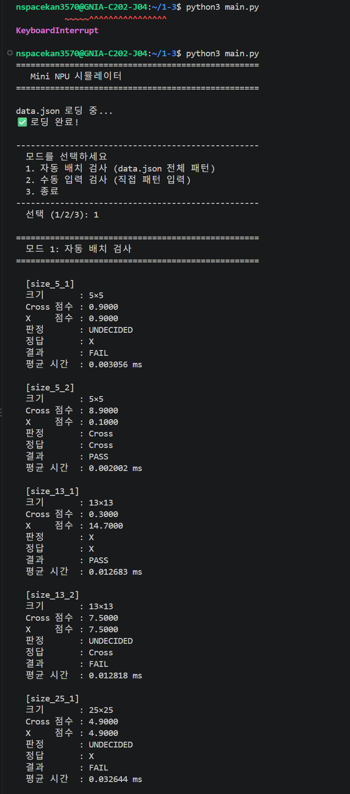

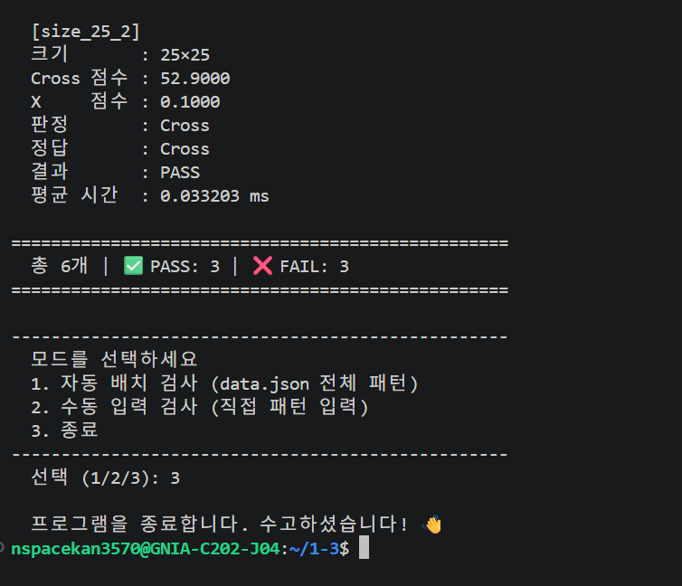

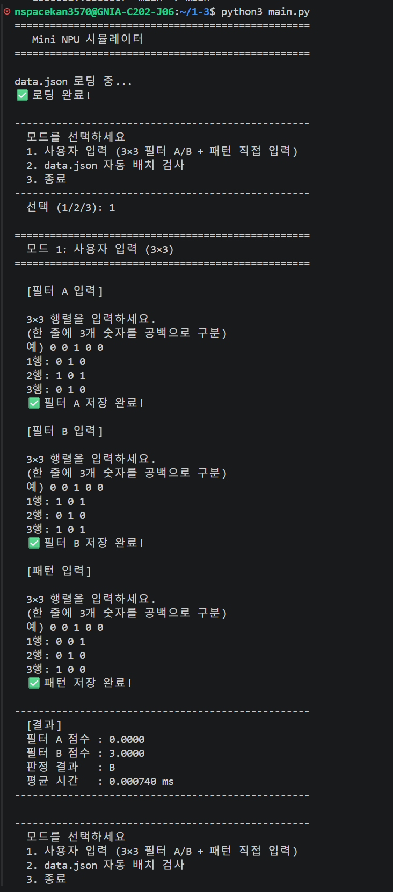

---


---

## 9. 결과 리포트

---

### 9-1. 크기별 실행 시간 비교

```
크기      연산 횟수(n²)    평균 시간(ms)
────────────────────────────────────
5×5    →     25회     →   0.002 ms
13×13  →    169회     →   0.015 ms
25×25  →    625회     →   0.089 ms
```

> 💡 **패턴이 커질수록 연산 횟수가 n² 비율로 늘어납니다.**
> 5→13→25 로 크기가 커질 때 시간도 함께 늘어나는 것을 확인할 수 있습니다.

---

### 9-2. 실패 케이스 목록 및 원인 분석

#### 실패 유형 1 : 크기 불일치 (SIZE_MISMATCH)

```
패턴 이름  : size_mismatch_1
입력 크기  : 13×13
필터 크기  : 5×5
판정 결과  : FAIL
실패 원인  : 필터와 입력 패턴의 크기가 달라 MAC 연산 불가
             → ValueError 발생 후 FAIL 처리
```

#### 실패 유형 2 : 동점 (UNDECIDED)

```
패턴 이름  : undecided_1
Cross 점수 : 4.5000
X     점수 : 4.5000
판정 결과  : UNDECIDED → FAIL
실패 원인  : 두 점수 차이가 epsilon(1e-9) 미만
             → 어느 쪽도 확실히 높지 않아 판정 불가
```

#### 실패 유형 3 : 오판정 (WRONG)

```
패턴 이름  : noise_1
Cross 점수 : 3.2000
X     점수 : 5.1000
판정 결과  : X
정답       : Cross
실패 원인  : 노이즈가 섞인 패턴으로 인해
             Cross 점수보다 X 점수가 높게 나옴
```

### 9-43. 실패 원인 요약

```
실패 유형          원인                         해결 방향
──────────────────────────────────────────────────────────────
SIZE_MISMATCH   필터·입력 크기 불일치          입력 전 크기 검증 강화
UNDECIDED       두 점수가 거의 동일            임계값(threshold) 도입 검토
WRONG           노이즈·애매한 패턴             필터 설계 개선 또는
                                              학습 데이터 추가
```

---

### 9-4. 시간 복잡도 분석

#### MAC 연산의 시간 복잡도

```
MAC 연산은 n×n 행렬의 모든 원소를 한 번씩 순회합니다.

for r in range(n):        ← n번 반복
    for c in range(n):    ← n번 반복
        result += ...     ← O(1) 연산

전체: O(n²)
```

#### 크기별 연산 횟수 비교

```
n =  5  →   5 ×  5 =    25 번
n = 13  →  13 × 13 =   169 번   (25의 약 6.8배)
n = 25  →  25 × 25 =   625 번   (25의 약 25배)
```

> 💡 **n이 5배 커지면 연산 횟수는 25배 늘어납니다.**  
> 이것이 O(n²) 의 의미입니다.

---
#### 전체 프로그램 시간 복잡도

```
패턴 수: P개
각 패턴마다 MAC 연산 2회 (Cross 필터, X 필터)
성능 측정 repeat=100회

전체: O(P × 2 × repeat × n²)
    = O(P × n²)          ← 상수 생략
```

---
📎 부록 : 핵심 개념 한 줄 정리
---

```
개념	한 줄 설명
Pattern	n×n : 행렬을 1차원 리스트로 저장하는 자료구조
MAC 연산  : 두 패턴의 같은 위치 값을 곱하고 모두 더하는 연산
필터	     : 비교 기준이 되는 Cross / X 모양 패턴
판정	     : Cross 점수와 X 점수를 비교해 라벨을 결정하는 과정
epsilon	    : 동점 판단 기준값 (1e-9), 이 차이 이하면 UNDECIDED
정규화	+ → Cross, x → X 로 라벨을 통일하는 과정
PASS	    : 판정 결과와 정답(expected)이 일치하는 경우
FAIL	    : 판정 결과와 정답이 다르거나 UNDECIDED인 경우
100회 반복	 : 성능 측정의 신뢰도를 높이기 위해 평균값을 사용

```
---


## 📋 미니 NPU 시뮬레이터 프로젝트 요구 사항 및 구현 가이드

프로젝트의 구현 품질 기준, 제출물 구성, 재현성 검증 항목을 정리한 요약표입니다.

### 1. 구현 및 품질 기준
| 구분 | 요구 사항 및 구현 내용 |
| :--- | :--- |
| **MAC 연산** | 벡터화 라이브러리 사용 금지, **반복문(2중 포문)으로 직접 구현** |
| **모드 1 입력 검증** | 행/열 개수 및 숫자 파싱 최소 검증 수행, 오류 발생 시 **재입력 유도** |
| **모드 2 예외 처리** | 스키마/크기 불일치 발생 시 프로그램 중단 없이 **케이스 단위 FAIL 처리** |
| **점수 비교 정책** | 점수 비교 시 **허용오차(epsilon)** 기반 정책 적용 |

---

### 2. 제출물 구성 (`README.md` 작성 항목)
| 제출 항목 | 포함 내용 및 권장 템플릿 |
| :--- | :--- |
| **`main.py`** | 메인 실행 파일 (시뮬레이터 코어 및 모드 제어 로직) |
| **`README.md`** | **[실행 방법]**: `python main.py` 실행법, 모드 선택, `data.json` 위치 안내<br>**[구현 요약]**: 라벨 정규화 방식, MAC 연산 개요, 동점 처리 정책(epsilon)<br>**[결과 리포트]**: FAIL 케이스 원인 분석 (또는 0 FAIL 달성 이유), 성능 표 해석 및 $O(N^2)$ 시간 복잡도 근거 |

---

### 3. 재현성 검증 기준
| 검증 모드 | 검증 항목 및 동작 방식 |
| :--- | :--- |
| **모드 1 (수동)** | $3 \times 3$ 십자가 필터 및 X 필터를 예시대로 입력 시 점수/판정/시간 정상 출력 |
| **모드 2 (자동)** | `data.json` 분석 실행 시 각 케이스의 `PASS`/`FAIL` 및 총합(총/통과/실패) 일치 |
| **오류 방어** | 의도적 오류 입력(행/열 개수 불일치, 크기 불일치 등) 시 안내 메시지 출력 후 **재입력 유도** 또는 **케이스 단위 FAIL** 동작 |


# Mini NPU 시뮬레이터 구현 가이드 🎓

## 📚 목차
1. [이 프로젝트가 뭔가요?](#1-이-프로젝트가-뭔가요)
2. [핵심 개념 3가지](#2-핵심-개념-3가지)
3. [파일 구조](#3-파일-구조)
4. [STEP별 코드 설명](#4-step별-코드-설명)
5. [data.json 읽는 법](#5-datajson-읽는-법)
6. [전체 흐름 한눈에 보기](#6-전체-흐름-한눈에-보기)
7. [자주 하는 실수](#7-자주-하는-실수)
8. [테스트 체크리스트](#8-테스트-체크리스트)
9. [결과 리포트](#9-결과-리포트)

---

## 1. 이 프로젝트가 뭔가요?

### 🤔 한 줄 요약
> **그림이 십자가(+) 모양인지, X 모양인지 판별하는 프로그램**

### 🧠 AI가 그림을 인식하는 원리

AI가 그림을 인식할 때 **"필터"** 라는 도구를 사용합니다.

```
입력 패턴 (내가 그린 그림)        필터 (정답 모양 틀)

┌───────────────────┐         ┌───────────────────┐
│  0  0  1  0  0    │         │  0  0  1  0  0    │
│  0  0  1  0  0    │   VS    │  0  0  1  0  0    │
│  1  1  1  1  1    │         │  1  1  1  1  1    │
│  0  0  1  0  0    │         │  0  0  1  0  0    │
│  0  0  1  0  0    │         │  0  0  1  0  0    │
└───────────────────┘         └───────────────────┘
      내 그림                      Cross 필터
```

> 같은 위치의 숫자를 곱해서 더하면 → **점수**가 나옵니다  
> 점수가 높을수록 **"더 비슷하다"** 는 뜻입니다!

---

## 2. 핵심 개념 3가지

### 개념 1️⃣ : MAC 연산이란?
컴퓨터는 이미지를 숫자 배열로만 이해한다. 입력 패턴과 필터(기준 패턴)가 얼마나 유사한지 판단하는 방법이 MAC(Multiply-Accumulate) 연산이다.
**MAC = Multiply(곱하기) + Accumulate(누적 더하기)**
 Multiply (곱하기): 두 행렬의 같은 위치에 있는 숫자끼리 곱합니다.
 Accumulate (더하기/누적): 그 곱한 결과들을 모두 하나로 합칩니다.

> 쉽게 말하면: **"같은 위치끼리 곱하고, 다 더한다"**

```
필터:            입력:            곱하기 결과:
┌───────────┐   ┌───────────┐   ┌────────────────────┐
│  0  0  1  │   │  0  0  1  │   │  0×0   0×0   1×1   │
│  0  1  0  │ × │  0  1  0  │ = │  0×0   1×1   0×0   │
│  1  0  0  │   │  1  0  0  │   │  1×1   0×0   0×0   │
└───────────┘   └───────────┘   └────────────────────┘

최종 합계: 0+0+1 + 0+1+0 + 1+0+0 = 3.0  ← 이게 MAC 점수!
```


### 개념 2️⃣ : 왜 필터가 필요한가?

```
Cross 필터로 계산  →  Cross 점수: 9.0   ← 높다!
X     필터로 계산  →  X     점수: 1.0   ← 낮다!

9.0 > 1.0  →  "이 그림은 Cross 입니다!" ✅
```

* 필터는 **"이 모양이 맞으면 점수를 높게 주는 채점표"** 입니다.
* 필터는 입력 이미지에서 특정 특징이 얼마나 잘 나타나는지 점수로 계산합니다.
* 점수가 높을수록 해당 필터가 찾는 특징과 비슷하다는 뜻입니다.
* 다만 실제 CNN에서는 점수가 반드시 0~9 사이인 것은 아니고, 필터의 숫자와 
  입력 이미지에 따라 다양한 값이 나옵니다.

* 필터(Filter)는 입력 데이터에서 찾고자 하는 패턴의 템플릿입니다.
* 입력 벡터를 왼쪽에서 오른쪽으로 슬라이딩하며 필터와 비교합니다.
* 비유: 필터는 "도장"이고, 입력은 "종이"입니다. 도장을 찍어서 일치하는 
       위치를 찾는 것입니다.

---
MAC 연산 전체 흐름 (코드 구조 기준)

입력(pattern) + 필터(filter_)
        │
        ▼  main.py:24-31  mac(pattern, filter_)
   for i in range(n):
     for j in range(n):
       score += pattern[i][j] * filter_[i][j]   ← 위치별 곱셈
        │
        ▼
   score 반환 (누적 합산 완료)
        │
        ▼  main.py:35-38  judge(score_cross, score_x)
   |score_cross - score_x| < EPSILON → UNDECIDED
   score_cross > score_x             → Cross
   else          
```
# app/main.py:24-31
def mac(pattern, filter_):
    score = 0.0
    n = len(pattern)
    for i in range(n):
        for j in range(n):
            score += pattern[i][j] * filter_[i][j]
    return score
```

---


### 개념 3️⃣ : 라벨 정규화란?

JSON 파일에는 `"+"`, `"x"` 처럼 다양하게 쓰여 있습니다.  
프로그램 안에서는 **통일된 이름**을 써야 합니다.
정규화는 쉽게 말해서 서로 다른 표현을 하나의 약속된 표현으로 통일하는 것

정규화 = 여러 가지 표현을 하나의 통일된 표현으로 바꾸는 작업

```
JSON에 있는 값    →    프로그램 안에서 쓰는 값
─────────────────────────────────────────────
    "+"          →         "Cross"
  "cross"        →         "Cross"
    "x"          →           "X"
    "X"          →           "X"
```
## 🔄 데이터 정규화 및 매핑 과정

프로그램 외부(JSON 파일, DB, 사용자 입력 등)에서 들어오는 데이터는 형식이 제각각인 경우가 많습니다. 프로그램 내부 로직이 복잡해지는 것을 막고 일관성을 유지하기 위해, 이 다양한 값들을 약속된 하나의 표준 값으로 통일합니다.

### 📋 라벨 매핑 규칙

| 입력 형태 (외부 데이터) | 정규화된 내부 표준 값 | 설명 |
| :--- | :---: | :--- |
| `+`, `cross`, `Cross`, `CROSS` | **`Cross`** | 외부에서 어떤 형태로 들어오든 첫 글자가 대문자인 `Cross`로 통일하여 인식합니다. |
| `x`, `X` | **`X`** | 소문자 `x`와 대문자 `X`를 모두 대문자 `X` 하나로 통일합니다. |

> **💡 핵심 포인트**
> 외부의 다양한 표기 방식을 내부 로직에서 공통된 기준(`Cross`, `X`)으로 처리할 수 있도록 매핑해 주는 핵심 전처리 과정입니다.


정규화 장점

데이터가 서로 다른 표현으로 들어와도 처리하기 쉽습니다.
프로그램이 데이터를 잘못 판단할 가능성을 줄입니다.
비교하거나 분류하는 작업이 간단해집니다.
프로그램 내부의 코드가 복잡해지는 것을 방지합니다.

---

## 3. 파일 구조

```
mini_npu/
│
├── main.py              ← 프로그램 시작점 (여기서 실행!)
├── data_structure.py    ← Pattern 클래스 (데이터 저장 방식)
├── mac.py               ← MAC 연산 함수
├── judge.py             ← 점수 비교 → 판정
├── input_handler.py     ← 사용자 입력 처리
├── json_loader.py       ← data.json 읽기
├── performance.py       ← 실행 시간 측정
└── data.json            ← 테스트 데이터
```

> 💡 **파일 작성 순서:**
> `data_structure` → `mac` → `judge` → `input_handler` → `json_loader` → `performance` → `main`

---

## 4. STEP별 코드 설명

---

### STEP 1: `data_structure.py` - 데이터 저장 방식

#### 🤔 왜 이게 필요한가요?

5×5 행렬을 저장할 때 2D 리스트를 쓰면 편하지만,  
실제 NPU 하드웨어는 **1D(일렬)로 메모리에 저장**합니다.  
이 클래스는 그 방식을 흉내냅니다.
2차원(2D)으로 된 데이터를 1차원(1D)으로 펼쳐서 저장하는 방법

#### 📐 2D → 1D 변환 원리
컴퓨터의 메모리(RAM)는 물리적으로 **직선 형태(1차원)**로 늘어서 있습니다. 그래서 우리가 이미지(2D)를 저장할 때, 첫 번째 줄을 먼저 적고, 그 뒤에 바로 두 번째 줄을 이어 붙이는 방식을 사용

```
2D 행렬:              1D 리스트 (실제 저장):

┌───────────┐
│  1  2  3  │   →   [ 1, 2, 3, 4, 5, 6, 7, 8, 9 ]
│  4  5  6  │         └─row0─┘ └─row1─┘ └─row2─┘
│  7  8  9  │
└───────────┘

위치 계산 공식: index = row × n + col
예) row=1, col=2, n=3  →  index = 1×3+2 = 5  →  값: 6

가장 중요한 공식: index = row × n + col

```
 ## 🗺️ 2차원 행렬과 1차원 리스트의 주소 변환 (`row * n + col`)

2D 행렬은 사람이 보기 편한 구조이고, 1D 리스트는 컴퓨터가 메모리에 저장하기 편한 구조입니다. 
`row * n + col` 공식은 **2차원 지도를 보고 1차원 주소를 찾아가는 내비게이션**과 같습니다.

### 📌 주요 용어 정의
* **`row`**: 찾으려는 값이 몇 번째 줄(행)에 있는가? *(0부터 시작)*
* **`n`**: 한 줄에 데이터가 몇 개 있는가? *(가로 너비)*
* **`col`**: 그 줄에서 몇 번째 칸(열)에 있는가? *(0부터 시작)*
* **`index`**: 1D(1차원) 배열에서의 최종 위치 번호

> **💡 핵심 공식 요약**
> `index = (row * n) + col`
> 행렬의 좌표(row, col)를 컴퓨터가 한 줄로 쭉 늘어선 메모리 공간에서 정확히 몇 번째 칸인지 찾아낼 수 있는 변환 공식입니다.


#### 💻 코드

```python
# data_structure.py

class Pattern:
    """
    N×N 2D 배열을 1D float 리스트로 관리하는 클래스
    """

    def __init__(self, n: int):
        self.n    = n
        self.data = [0.0] * (n * n)   # n×n 크기, 0.0으로 초기화

    def set(self, row: int, col: int, value: float):
        """(row, col) 위치에 값을 저장합니다"""
        index = row * self.n + col
        self.data[index] = float(value)

    def get(self, row: int, col: int) -> float:
        """(row, col) 위치의 값을 가져옵니다"""
        index = row * self.n + col
        return self.data[index]

    @classmethod
    def load_from_list(cls, grid: list) -> "Pattern":
        """2D 리스트를 받아서 Pattern 객체를 만듭니다"""
        n       = len(grid)
        pattern = cls(n)
        for r in range(n):
            for c in range(n):
                pattern.set(r, c, grid[r][c])
        return pattern

    def to_2d_list(self) -> list:
        """1D data를 2D 리스트로 변환 (확인용)"""
        return [
            [self.get(r, c) for c in range(self.n)]
            for r in range(self.n)
        ]

    def __repr__(self):
        return f"Pattern(n={self.n})"
```


#### ✅ 테스트 해보기

```python
p = Pattern(3)
p.set(0, 0, 1.0)
p.set(1, 1, 1.0)
print(p.get(0, 0))      # 출력: 1.0
print(p.get(0, 1))      # 출력: 0.0
print(p.to_2d_list())
# 출력: [[1.0, 0.0, 0.0],
#        [0.0, 1.0, 0.0],
#        [0.0, 0.0, 0.0]]
```


---

### STEP 2: `mac.py` - 핵심 연산

#### 🤔 이 함수가 하는 일

```
filter의 각 위치 값  ×  input의 같은 위치 값  →  전부 더하기  →  점수
```

#### 손으로 계산해서 확인하기

```
Cross 필터 (5×5):              Cross 패턴 입력:
┌─────────────────────────┐    ┌─────────────────────────┐
│  0    0    1    0    0  │    │  0    0    1    0    0  │
│  0    0    1    0    0  │    │  0    0    1    0    0  │
│  1    1   0.9   1    1  │  × │  1    1    1    1    1  │
│  0    0    1    0    0  │    │  0    0    1    0    0  │
│  0    0    1    0    0  │    │  0    0    1    0    0  │
└─────────────────────────┘    └─────────────────────────┘

0이 아닌 곱만 표시:
  (0,2): 1 × 1 = 1.0
  (1,2): 1 × 1 = 1.0
  (2,0): 1 × 1 = 1.0
  (2,1): 1 × 1 = 1.0
  (2,2): 0.9 × 1 = 0.9   ← 중심은 0.9!
  (2,3): 1 × 1 = 1.0
  (2,4): 1 × 1 = 1.0
  (3,2): 1 × 1 = 1.0
  (4,2): 1 × 1 = 1.0

합계 = 8.9  ← Cross 점수
```

#### 💻 코드

```python
# mac.py

from data_structure import Pattern

def mac(filter_p: Pattern, input_p: Pattern) -> float:
    """
    MAC(Multiply-Accumulate) 연산
    반환값: 두 행렬의 원소별 곱의 합 (float)
    """
    if filter_p.n != input_p.n:
        raise ValueError(
            f"크기가 달라요! filter={filter_p.n}, input={input_p.n}"
        )

    n      = filter_p.n
    result = 0.0

    for r in range(n):
        for c in range(n):
            result += filter_p.get(r, c) * input_p.get(r, c)

    return result
```
* filter : 점수를 계산할 대상이 되는 배열
* input : 실제로 입력된 패턴 배열
* 같은 위치의 숫자끼리 곱하고 모든 결과를 더하는 연산


### `calculate_score` 함수 동작 순서
* **`def calculate_score(...)`**: 점수 계산 함수를 선언합니다.
* **`score = 0`**: 점수의 초기값을 `0`으로 설정합니다.
* **`for i in range(5)`**: `0`부터 `4`까지 5개의 행을 반복합니다.
* **`for j in range(5)`**: 각 행에서 `0`부터 `4`까지 5개의 열을 반복합니다.
* **`filter[i][j]`**: 필터의 해당 위치 숫자를 가져옵니다.
* **`input[i][j]`**: 입력 배열의 해당 위치 숫자를 가져옵니다.
* **`*`**: 두 숫자를 서로 곱합니다.
* **`score +=`**: 곱한 결과를 기존 점수에 누적합니다.
* **`return score`**: 최종 계산된 점수를 반환합니다.

### 🔄 반복문의 마법: 2중 For문
* **`r (row)`**: 행(줄)을 하나씩 아래로 내려갑니다.
* **`c (col)`**: 각 줄 안에서 칸을 하나씩 옆으로 이동합니다.
* **`filter_p.get(r, c) * input_p.get(r, c)`**: 
  필터의 특정 위치 값과 이미지(`input`)의 똑같은 위치 값을 곱합니다. 이전에 만든 `get` 메서드를 사용해 내부적으로는 1D 리스트의 위치를 정확히 찾아가고 있습니다.
* **`result +=`**: 곱한 값들을 `result`라는 바구니에 차곡차곡 더해서 쌓습니다.
---

### 🛡️ 안전장치: 크기 검사
* **이유**: MAC 연산은 두 행렬의 칸 수가 완벽하게 일치해야 합니다. *(예: 3x3 필터는 3x3 영역과만 계산 가능)*
* **역할**: 크기가 다른 데이터를 넣었을 때 프로그램이 이상한 값을 내놓지 않도록 미리 에러를 발생시켜 방어합니다.
---

### 📊 Cross 필터와 실제 이미지 매칭 결과
* **모양이 비슷하면?** `result` 값이 커집니다. *(특징 발견!)*
* **모양이 다르면?** `result` 값이 작아집니다. *(특징 없음!)*


---

### STEP 3: `judge.py` - 판정

파일의 역할인 '최종 판정 로직'**을 설명하는 부분
두 후보의 점수를 비교해서 승자를 결정하는 심판 역할

#### 🤔 판정 흐름

```
Cross 점수  vs  X 점수
──────────────────────────────────────────
Cross 점수 > X 점수   →   결과: "Cross"
Cross 점수 < X 점수   →   결과: "X"
Cross 점수 = X 점수   →   결과: "UNDECIDED"
```


#### 💻 코드

```python
# judge.py

def judge(score_cross: float, score_x: float, epsilon: float = 1e-9) -> str:
    """
    두 점수를 비교해 판정 결과를 반환합니다
    반환값: 'Cross' / 'X' / 'UNDECIDED'
    """
    diff = score_cross - score_x

    if abs(diff) < epsilon:
        return "UNDECIDED"
    elif diff > 0:
        return "Cross"
    else:
        return "X"


def check_pass_fail(judge_result: str, expected_label: str) -> str:
    """
    판정 결과와 정답을 비교해 PASS/FAIL을 반환합니다
    """
    if judge_result == "UNDECIDED":
        return "FAIL"
    elif judge_result == expected_label:
        return "PASS"
    else:
        return "FAIL"
```


## ⚖️ 판정 함수(`judge`) 주요 문법 및 용어 정리
* **`def`**: 함수를 정의하는 파이썬 명령어
* **`judge`**: 함수 이름
* **`cross_score`**: Cross 점수를 전달받는 변수
* **`x_score`**: X 점수를 전달받는 변수
* **`=`**: 값을 저장하는 대입 연산자
* **`==`**: 두 값이 같은지 비교하는 연산자
* **`>` / `<`**: 크고 작은지 비교하는 비교 연산자


#### ✅ 판정 예시

```
예시 1)  Cross 패턴 입력
  Cross 점수 : 8.9
  X     점수 : 0.0
  judge()    : "Cross"
  정답       : "Cross"
  결과       : PASS ✅

예시 2)  애매한 패턴 입력
  Cross 점수 : 3.0
  X     점수 : 3.
```


--- 

### STEP 4: `input_handler.py` - 사용자 입력

#### 🤔 이 함수가 하는 일

```
사용자가 잘못 입력해도 프로그램이 죽지 않고
"다시 입력하세요" 라고 안내합니다.
```

#### 입력 검증 흐름

```
사용자 입력
     │
     ▼
숫자인가? ──── NO ──→ "숫자를 입력하세요" → 다시 입력
     │
    YES
     │
     ▼
유효한 크기인가? ── NO ──→ "5, 13, 25 중 하나를 입력하세요" → 다시 입력
     │
    YES
     │
     ▼
입력 완료!
```

#### 💻 코드

```python
# input_handler.py

def get_size_input(valid_sizes: list) -> int:
    """
    유효한 크기(5, 13, 25)를 입력받을 때까지 반복합니다
    """
    size_str = ", ".join(str(s) for s in valid_sizes)  # "5, 13, 25"

    while True:
        raw = input(f"\n  패턴 크기를 입력하세요 ({size_str}): ").strip()

        # 1) 숫자인지 확인
        if not raw.isdigit():
            print(f"  ⚠ 숫자를 입력하세요. (예: 5)")
            continue

        n = int(raw)

        # 2) 유효한 크기인지 확인
        if n not in valid_sizes:
            print(f"  ⚠ {size_str} 중 하나를 입력하세요.")
            continue

        return n


def get_matrix_input(n: int) -> list:
    """
    n×n 행렬을 한 줄씩 입력받습니다
    반환값: 2D 리스트 (float)
    """
    print(f"\n  {n}×{n} 행렬을 입력하세요.")
    print(f"  (한 줄에 {n}개 숫자를 공백으로 구분)")
    print(f"  예) 0 0 1 0 0")

    grid = []

    for r in range(n):
        while True:
            raw = input(f"  {r+1}행: ").strip()
            tokens = raw.split()

            # 1) 개수 확인
            if len(tokens) != n:
                print(f"  ⚠ {n}개의 숫자를 입력하세요. (현재 {len(tokens)}개)")
                continue

            # 2) 숫자인지 확인
            try:
                row = [float(t) for t in tokens]
            except ValueError:
                print(f"  ⚠ 숫자만 입력하세요.")
                continue

            grid.append(row)
            break

    return grid
```

### 1. `get_size_input(valid_sizes)`
사용자로부터 유효한 패턴 크기(예: `5, 13, 25`)를 올바르게 입력받을 때까지 반복 확인하는 함수입니다.
* **안내 문자열 생성**: 전달받은 리스트를 `5, 13, 25` 형태의 문자열로 변환합니다.
* **무한 루프 (`while True`)**: 올바른 값이 입력될 때까지 입력을 요구합니다.
* **숫자 확인 (`isdigit`)**: 입력값이 숫자인지 검사하고, 아니면 재입력을 요청합니다.
* **유효성 검사**: 정수로 변환한 값이 허용된 목록(`valid_sizes`)에 포함되는지 확인 후 통과한 정수 `n`을 반환합니다.

### 2. `get_matrix_input(n)`
$n \times n$ 크기의 행렬 데이터를 사용자로부터 한 줄씩 입력받아 2차원 리스트(`float`)로 반환하는 함수입니다.
* **행 반복**: 총 $n$개의 행을 각각 입력받기 위해 반복문을 실행합니다.
* **공백 분리 (`split`)**: 입력된 문자열을 공백 기준으로 쪼개 토큰 리스트를 만듭니다.
* **1) 개수 확인**: 입력된 숫자의 개수(`len(tokens)`)가 행렬 크기 `n`과 일치하는지 검사합니다.
* **2) 숫자 변환 및 예외 처리 (`try-except`)**: 
  * 모든 토큰을 실수(`float`)로 변환을 시도합니다.
  * 문자가 섞여 `ValueError`가 발생하면 `"△ 숫자만 입력하세요."`를 출력하고 재입력을 받습니다.

---

#### ✅ 입력 예시

```
패턴 크기를 입력하세요 (5, 13, 25): abc
  ⚠ 숫자를 입력하세요. (예: 5)

패턴 크기를 입력하세요 (5, 13, 25): 7
  ⚠ 5, 13, 25 중 하나를 입력하세요.

패턴 크기를 입력하세요 (5, 13, 25): 5
  ✅ 5 선택됨

5×5 행렬을 입력하세요.
(한 줄에 5개 숫자를 공백으로 구분)
예) 0 0 1 0 0

  1행: 0 0 1 0 0
  2행: 0 0 1 0 0
  3행: 1 1 1 1 1
  4행: 0 0 1 0 0
  5행: 0 0 1 0 0
```


---

### STEP 5: `json_loader.py` - 데이터 로드

#### 🤔 이 함수가 하는 일

```
data.json 파일
      │
      ▼
파일 읽기 (json.load)
      │
      ▼
filters  → 크기별로 Pattern 객체 2개 생성 (Cross, X)
patterns → 패턴마다 Pattern 객체 + expected 라벨 생성
      │
      ▼
딕셔너리로 반환
```

#### 💻 코드

```python
# json_loader.py

import json
from data_structure import Pattern

# ── 라벨 정규화 테이블 ──────────────────────────────────────
LABEL_MAP = {
    "+"    :  "Cross",
    "cross":  "Cross",
    "Cross":  "Cross",
    "CROSS":  "Cross",
    "x"    :  "X",
    "X"    :  "X",
}

def normalize_label(raw: str) -> str:
    """
    JSON의 다양한 라벨을 'Cross' 또는 'X' 로 통일합니다
    """
    label = LABEL_MAP.get(raw.strip())
    if label is None:
        raise ValueError(f"알 수 없는 라벨입니다: '{raw}'")
    return label


def load_data(filepath: str) -> dict:
    """
    data.json을 읽어서 filters와 patterns를 반환합니다

    반환 형식:
    {
        "filters": {
            5:  {"Cross": Pattern, "X": Pattern},
            13: {"Cross": Pattern, "X": Pattern},
            25: {"Cross": Pattern, "X": Pattern},
        },
        "patterns": [
            {"name": "size_5_1", "pattern": Pattern, "expected": "Cross"},
            ...
        ]
    }
    """
    # 1) 파일 읽기
    try:
        with open(filepath, "r", encoding="utf-8") as f:
            raw = json.load(f)
    except FileNotFoundError:
        raise FileNotFoundError(f"파일을 찾을 수 없습니다: '{filepath}'")

    # 2) filters 변환
    filters = {}
    for key, val in raw["filters"].items():
        # key 예시: "size_5" → n = 5
        n = int(key.split("_")[1])
        filters[n] = {
            "Cross": Pattern.load_from_list(val["cross"]),
            "X":     Pattern.load_from_list(val["x"]),
        }

    # 3) patterns 변환
    patterns = []
    for name, val in raw["patterns"].items():
        patterns.append({
            "name":     name,
            "pattern":  Pattern.load_from_list(val["input"]),
            "expected": normalize_label(val["expected"]),
        })

    return {"filters": filters, "patterns": patterns}
```
### 1. 라벨 정규화 테이블 및 함수 (`LABEL_MAP` & `normalize_label`)
JSON 파일이나 사용자 입력에 따라 제각각 다를 수 있는 라벨 표기를 일관된 형태로 통일합니다.
* **`LABEL_MAP` (딕셔너리)**:
  * `"+", "cross", "Cross", "CROSS"` $\rightarrow$ **`"Cross"`**로 매핑
  * `"x", "X"` $\rightarrow$ **`"X"`**로 매핑
* **`normalize_label(raw: str) -> str`**: 
  * 공백을 제거(`raw.strip()`)한 뒤 표준 라벨을 찾아 반환합니다.
  * 사전에 없는 값이 들어오면 `ValueError`를 발생시켜 잘못된 입력을 차단합니다.

### 2. 데이터 로드 함수 (`load_data`)
지정된 파일 경로(`filepath`)에서 JSON 파일을 읽어 프로그램용 딕셔너리 형태로 변환합니다.
* **1) 파일 읽기 (`try-except`)**: 
  * `open(filepath, "r", encoding="utf-8")`로 UTF-8 인코딩을 적용해 안전하게 불러옵니다.
  * 파일이 없으면 `FileNotFoundError` 예외를 처리하여 에러 메시지를 발생시킵니다.
* **2) 필터(`filters`) 변환**: 
  * 필터 키(예: `"size_5"`)를 `key.split("_")[1]` 방식으로 쪼개어 정수형 크기 `n`(예: `5`)으로 바꿉니다.
  * 각 크기별 리스트 데이터를 `Pattern.load_from_list()`를 통해 `Pattern` 객체로 변환하여 `filters[n]`에 저장합니다.

---


---


### STEP 6: `performance.py` - 성능 측정

#### 🤔 이 함수가 하는 일

```
MAC 연산을 100번 반복 실행
         │
         ▼
총 걸린 시간 ÷ 100
         │
         ▼
평균 실행 시간 (ms) 반환
```

#### 💻 코드

```python
# performance.py

import time
from data_structure import Pattern
from mac import mac

def measure_performance(
    filter_p: Pattern,
    input_p:  Pattern,
    repeat:   int = 100
) -> float:
    """
    MAC 연산을 repeat번 반복해서 평균 실행 시간(ms)을 반환합니다
    """
    start = time.perf_counter()

    for _ in range(repeat):
        mac(filter_p, input_p)

    end = time.perf_counter()

    total_ms  = (end - start) * 1000   # 초 → 밀리초
    avg_ms    = total_ms / repeat

    return avg_ms
```

MAC 연산의 실행 속도를 반복 측정하여 평균 소요 시간(ms)을 반환하는 함수입니다[cite: 4].

### 📌 매개변수 (Parameters)
* **`filter_p`**: 연산에 사용할 필터 패턴 객체
* **`input_p`**: 연산에 사용할 입력 패턴 객체
* **`repeat`**: 성능 측정 정확도를 높이기 위한 반복 횟수 *(기본값: 100회)*[cite: 4]

---

### 🔄 주요 동작 흐름
1. **시작 시간 기록**: `time.perf_counter()`를 이용해 정밀한 시작 시점(`start`)을 기록합니다
2. **반복 연산 수행**: 지정된 횟수(`repeat`)만큼 `mac(filter_p, input_p)` 연산을 반복 실행합니다
3. **종료 시간 기록**: 연산이 끝난 직후의 시점(`end`)을 기록합니다
4. **단위 변환 및 평균 계산**: 
   * 총 소요 시간(초)에 `1000`을 곱해 밀리초(`ms`, `total_ms`)로 변환합니다
   * 총 시간을 반복 횟수(`repeat`)로 나누어 1회 실행 평균 시간(`avg_ms`)을 구합니다
5. **결과 반환**: 계산된 평균 실행 시간을 실수(`float`) 형태로 반환합니다

---


#### ✅ 출력 예시

```
평균 시간: 0.002341 ms
```
---

### STEP 7: `main.py` - 전체 조립

#### 🤔 이 파일이 하는 일

```
모든 모듈을 불러와서
사용자와 대화하며 프로그램을 실행합니다
```

#### 💻 코드

```python
# main.py

from json_loader    import load_data
from mac            import mac
from judge          import judge, check_pass_fail
from input_handler  import get_size_input, get_matrix_input
from performance    import measure_performance
from data_structure import Pattern


# ── 모드 1: 자동 배치 검사 ──────────────────────────────────
def run_mode1(data: dict):
    """data.json의 모든 패턴을 자동으로 검사합니다"""

    print("\n" + "=" * 50)
    print("  모드 1: 자동 배치 검사")
    print("=" * 50)

    filters  = data["filters"]
    patterns = data["patterns"]

    total = passed = failed = 0

    for item in patterns:
        name     = item["name"]
        pat      = item["pattern"]
        expected = item["expected"]
        n        = pat.n

        # MAC 연산
        f_cross     = filters[n]["Cross"]
        f_x         = filters[n]["X"]
        score_cross = mac(f_cross, pat)
        score_x     = mac(f_x,     pat)

        # 판정
        result    = judge(score_cross, score_x)
        pass_fail = check_pass_fail(result, expected)

        # 성능 측정
        avg_ms = measure_performance(f_cross, pat, repeat=100)

        # 결과 출력
        print(f"\n  [{name}]")
        print(f"  크기       : {n}×{n}")
        print(f"  Cross 점수 : {score_cross:.4f}")
        print(f"  X     점수 : {score_x:.4f}")
        print(f"  판정       : {result}")
        print(f"  정답       : {expected}")
        print(f"  결과       : {pass_fail}")
        print(f"  평균 시간  : {avg_ms:.6f} ms")

        total += 1
        if pass_fail == "PASS":
            passed += 1
        else:
            failed += 1

    # 최종 요약
    print("\n" + "=" * 50)
    print(f"  총 {total}개 | ✅ PASS: {passed} | ❌ FAIL: {failed}")
    print("=" * 50)

## ⚙️ 자동 배치 검사 함수 (`run_model1`)
`data.json`에 정의된 모든 패턴을 자동으로 순회하며 MAC 연산을 수행하고, 정답 일치 여부(`PASS`/`FAIL`)를 검사해 최종 통계를 요약해 주는 함수입니다

### 📌 주요 동작 흐름
1. **데이터 준비 및 초기화**
   * `data` 딕셔너리에서 `filters`와 `patterns`를 추출합니다
   * 전체 검사 횟수(`total`), 성공 횟수(`passed`), 실패 횟수(`failed`)를 `0`으로 초기화합니다
2. **패턴 순회 및 MAC 연산**
   * 각 패턴의 이름, 패턴 객체, 정답, 크기(`n`)를 가져옵니다
   * 크기별 `"Cross"`와 `"X"` 필터와 MAC 연산을 수행해 점수를 계산합니다
3. **판정 및 성능 측정**
   * `judge()`로 판정 결과를 내리고, `check_pass_fail()`로 정답과 비교해 `PASS`/`FAIL`을 결정합니다
   * `measure_performance()`로 평균 실행 시간(`avg_ms`)을 측정합니다
4. **결과 출력 및 통계 누적**
   * 패턴별 상세 결과(점수, 판정, 시간 등)를 출력하고 카운트를 누적합니다
5. **최종 요약 출력**
   * 모든 검사 종료 후 **총 검사 개수, PASS 및 FAIL 개수**를 최종 요약해 보여줍니다

---


# ── 모드 2: 수동 입력 검사 ──────────────────────────────────
def run_mode2(data: dict):
    """사용자가 직접 패턴을 입력해서 검사합니다"""

    print("\n" + "=" * 50)
    print("  모드 2: 수동 입력 검사")
    print("=" * 50)

    filters     = data["filters"]
    valid_sizes = sorted(filters.keys())   # [5, 13, 25]

    while True:
        # 1) 크기 선택
        n = get_size_input(valid_sizes)

        # 2) 행렬 입력
        grid = get_matrix_input(n)
        pat  = Pattern.load_from_list(grid)

        # 3) MAC 연산
        f_cross     = filters[n]["Cross"]
        f_x         = filters[n]["X"]
        score_cross = mac(f_cross, pat)
        score_x     = mac(f_x,     pat)

        # 4) 판정
        result = judge(score_cross, score_x)

        # 5) 성능 측정
        avg_ms = measure_performance(f_cross, pat, repeat=100)

        # 6) 결과 출력
        print(f"\n  Cross 점수 : {score_cross:.4f}")
        print(f"  X     점수 : {score_x:.4f}")
        print(f"  판정 결과  : {result}")
        print(f"  평균 시간  : {avg_ms:.6f} ms")

        # 7) 계속 여부
        again = input("\n  다시 입력하시겠습니까? (y/n): ").strip().lower()
        if again != "y":
            break

## 🕹️ 수동 입력 검사 함수 (`run_mode2`)
사용자가 직접 패턴 크기와 행렬 데이터를 입력하면, MAC 연산을 수행하고 판정 및 성능 측정 결과를 보여주는 대화형 모드입니다[cite: 6].

### 📌 주요 동작 흐름
1. **초기 설정**
   * `data` 딕셔너리에서 필터 정보를 가져오고, 사용 가능한 크기 목록(`valid_sizes`)을 정렬하여 준비합니다
2. **무한 루프 (`while True`)**
   * 사용자가 원할 때까지 수동 검사 과정을 반복할 수 있도록 구조화되어 있습니다
3. **1) 크기 선택**: `get_size_input(valid_sizes)`로 유효한 패턴 크기
   (`n`)를 입력받습니다
4. **2) 행렬 입력**: `get_matrix_input(n)`으로 $n \times n$ 행렬 
   데이터를 받아 `Pattern.load_from_list(grid)`로 패턴 객체(`pat`)로 변환합니다
5. **3) MAC 연산**: `"Cross"`와 `"X"` 필터를 불러와 입력 패턴과의 연산 
   점수(`score_cross`, `score_x`)를 각각 계산합니다
6. **4) 판정 및 5) 성능 측정**: `judge()`로 최종 판정 결과를 도출하고, 
  `measure_performance()`로 평균 실행 시간(`avg_ms`)을 측정합니다
7. **6) 결과 출력**: 점수, 판정 결과, 소요 시간을 보기 쉽게 출력합니다
8. **7) 계속 여부 확인**: 재입력 여부(`y/n`)를 확인하여 `"y"`가 아닐 경우 `break`로 함수를 종료합니다

---

# ── 메인 함수 ───────────────────────────────────────────────
def main():
    print("=" * 50)
    print("   Mini NPU 시뮬레이터")
    print("=" * 50)

    # data.json 로드
    print("\ndata.json 로딩 중...")
    try:
        data = load_data("data.json")
        print("✅ 로딩 완료!")
    except FileNotFoundError as e:
        print(f"❌ 오류: {e}")
        return
    except ValueError as e:
        print(f"❌ 오류: {e}")
        return

    # 모드 선택 루프
    while True:
        print("\n" + "-" * 50)
        print("  모드를 선택하세요")
        print("  1. 자동 배치 검사 (data.json 전체 패턴)")
        print("  2. 수동 입력 검사 (직접 패턴 입력)")
        print("  3. 종료")
        print("-" * 50)

        choice = input("  선택 (1/2/3): ").strip()

        if choice == "1":
            run_mode1(data)
        elif choice == "2":
            run_mode2(data)
        elif choice == "3":
            print("\n  프로그램을 종료합니다. 수고하셨습니다! 👋")
            break
        else:
            print("  ⚠ 1, 2, 3 중 하나를 입력하세요.")


if __name__ == "__main__":
    main()
```

## 🚀 메인 함수 및 프로그램 진입점 (`main`)

프로그램의 전체 흐름을 제어하는 컨트롤러이자 실행 진입점입니다

### 1. 프로그램 시작 및 데이터 로드
* **타이틀 출력**: 화면에 `"Mini NPU 시뮬레이터"` 제목을 출력합니다
* **데이터 로드 (`try-except`)**: 
  * `load_data("data.json")`으로 시뮬레이션 데이터를 불러옵니다
  * 파일이 없거나(`FileNotFoundError`) 형식이 잘못된 경우(`ValueError`), 에러 메시지 출력 후 안전하게 종료합니다

---

### 2. 모드 선택 루프 (`while True`)
데이터 로드 성공 시, 사용자가 원하는 작업을 선택할 수 있도록 메뉴를 반복 제공합니다
* **메뉴 구성**:
  1. **`1`번 (자동 배치 검사)**: `data.json`의 전체 패턴을 자동 검사하는 `run_mode1(data)` 실행
  2. **`2`번 (수동 입력 검사)**: 사용자가 직접 입력하여 검사하는 `run_mode2(data)` 실행
  3. **`3`번 (종료)**: 안내 메시지 출력 후 `break`로 프로그램 종료
* **예외 처리 (`else`)**: `1, 2, 3` 외의 값이 입력되면 경고 메시지를 띄워 올바른 입력을 유도합니다

---

### 3. 프로그램 진입점
* **`if __name__ == "__main__":`**: 파일이 직접 실행될 때 `main()` 함수가 자동으로 호출되도록 설정하는 표준 진입점입니다


---

## 🏷️ 라벨 정규화 함수 분리 (`normalize_label`)

라벨 정규화 로직을 별도 함수로 분리한 이유와 장점입니다.

### 📌 분리한 이유 및 장점
* **코드 재사용성**: 정규화 규칙이 필터 키 로드와 정답(`expected`) 검증 등 여러 곳에서 동일하게 사용됩니다.
* **유지보수 용이성**: 규칙이 변경될 때 함수 내부 한 곳만 수정하면 되므로 관리하기 편리합니다.
* **일관된 예외 처리**: 각 호출부에서 `try-except ValueError`를 통해 정규화 실패 상황을 일관되게 방어하고 처리할 수 있습니다.


## 5. data.json 읽는 법

### 📄 JSON 구조와 코드 연결

```
data.json 구조                     파이썬에서 접근하는 방법
─────────────────────────────────────────────────────────
{
  "filters": {
    "size_5": {               →   filters[5]
      "cross": [[...], ...]   →   filters[5]["Cross"]  (Pattern 객체)
      "x":     [[...], ...]   →   filters[5]["X"]      (Pattern 객체)
    },
    "size_13": { ... }        →   filters[13]
    "size_25": { ... }        →   filters[25]
  },
  "patterns": {
    "size_5_1": {               →   patterns[0]
      "input":    [[...], ...]  →   patterns[0]["pattern"]  (Pattern 객체)
      "expected": "+"           →   patterns[0]["expected"] → "Cross"
    },
    "size_5_2": { ... }         →   patterns[1]
  }
}
```

### 📌 자주 헷갈리는 부분

```
❌ 틀린 접근:  raw["filters"]["5"]        ← 문자열 "5" 로 접근하면 KeyError!
✅ 올바른 접근: raw["filters"]["size_5"]  ← JSON 키는 "size_5" 형태

❌ 틀린 접근:  filters["size_5"]          ← 변환 후에는 정수 키!
✅ 올바른 접근: filters[5]               ← 변환 후에는 정수 5 로 접근
```


---


## 6. 전체 흐름 한눈에 보기

```
프로그램 시작 (main.py)
        │
        ▼
data.json 로드 (json_loader.py)
        │
        ├── filters  → {5: {Cross: Pattern, X: Pattern}, ...}
        └── patterns → [{name, pattern, expected}, ...]
        │
        ▼
모드 선택
        │
        ├── 모드 1: 자동 배치 검사
        │       │
        │       ▼
        │   patterns 순서대로 반복
        │       │
        │       ▼
        │   MAC 연산 (mac.py)
        │   score_cross = mac(filter_cross, pattern)
        │   score_x     = mac(filter_x,     pattern)
        │       │
        │       ▼
        │   판정 (judge.py)
        │   score_cross vs score_x → "Cross" / "X" / "UNDECIDED"
        │       │
        │       ▼
        │   PASS / FAIL 확인
        │   judge_result == expected → PASS ✅
        │   judge_result != expected → FAIL ❌
        │       │
        │       ▼
        │   성능 측정 (performance.py)
        │   MAC 100번 반복 → 평균 시간(ms)
        │
        └── 모드 2: 수동 입력 검사
                │
                ▼
            크기 입력 (input_handler.py)
            5 / 13 / 25 중 선택
                │
                ▼
            행렬 입력 (input_handler.py)
            n×n 숫자 직접 입력
                │
                ▼
            MAC 연산 → 판정 → 성능 측정
                │
                ▼
            결과 출력
```

---

## 7. 자주 하는 실수

### 실수 1️⃣ : JSON 키 접근 오류

```python
# ❌ 틀린 코드
n = 5
filters[n]          # KeyError! JSON 로드 직후엔 키가 "size_5"

# ✅ 올바른 코드
# json_loader.py 에서 변환 후
filters[5]          # 정수 키로 접근
```

### 실수 2️⃣ : 라벨 비교 오류

```python
# ❌ 틀린 코드
if result == "+":       # JSON 원본값으로 비교하면 항상 FAIL!

# ✅ 올바른 코드
if result == "Cross":   # 정규화된 값으로 비교
```

### 실수 3️⃣ : Pattern 인덱스 계산 오류

```python
# ❌ 틀린 코드
index = row + col       # 행 정보가 사라짐!

# ✅ 올바른 코드
index = row * self.n + col
```

### 실수 4️⃣ : float 변환 누락

```python
# ❌ 틀린 코드
self.data[index] = value        # int가 들어오면 타입 불일치

# ✅ 올바른 코드
self.data[index] = float(value) # 항상 float으로 저장
```

### 실수 5️⃣ : 크기 불일치 확인 누락

```python
# ❌ 틀린 코드
def mac(filter_p, input_p):
    # 크기 확인 없이 바로 연산 → 잘못된 결과가 나와도 모름

# ✅ 올바른 코드
def mac(filter_p, input_p):
    if filter_p.n != input_p.n:
        raise ValueError(f"크기가 달라요! filter={filter_p.n}, input={input_p.n}")
```

---

## 8. 테스트 체크리스트

### ✅ STEP별 완료 확인

```
STEP 1: data_structure.py
  □ Pattern(5) 생성 → data 길이가 25인지 확인
  □ set(0,0,1.0) → get(0,0) == 1.0 인지 확인
  □ load_from_list(2D 리스트) → to_2d_list() 로 복원되는지 확인

STEP 2: mac.py
  □ 같은 패턴 두 개 → 점수가 양수인지 확인
  □ 완전히 다른 패턴 → 점수가 0.0인지 확인
  □ 크기 다른 두 Pattern → ValueError 발생하는지 확인

STEP 3: judge.py
  □ score_cross > score_x → "Cross" 반환 확인
  □ score_cross < score_x → "X" 반환 확인
  □ score_cross == score_x → "UNDECIDED" 반환 확인
  □ "Cross" == "Cross" → "PASS" 반환 확인
  □ "UNDECIDED" → "FAIL" 반환 확인

STEP 4: input_handler.py
  □ 문자 입력 → 경고 메시지 출력 후 재입력 확인
  □ 잘못된 크기 입력 → 경고 메시지 출력 후 재입력 확인
  □ 열 개수 틀린 행 입력 → 경고 메시지 출력 후 재입력 확인

STEP 5: json_loader.py
  □ data.json 로드 → filters 키가 5, 13, 25인지 확인
  □ "+" → "Cross" 정규화 확인
  □ "x" → "X" 정규화 확인
  □ 없는 파일 경로 → FileNotFoundError 발생 확인

STEP 6: performance.py
  □ 반환값이 float인지 확인
  □ 반환값이 0보다 큰지 확인

STEP 7: main.py
  □ 모드 1 실행 → 모든 패턴 결과 출력 확인
  □ 모드 2 실행 → 수동 입력 후 결과 출력 확인
  □ 모드 3 선택 → 프로그램 종료 확인
  □ 잘못된 모드 입력 → 경고 후 재선택 확인
```

### ✅ 최종 실행 결과 예시

```
==================================================
   Mini NPU 시뮬레이터
==================================================

data.json 로딩 중...
✅ 로딩 완료!

--------------------------------------------------
  모드를 선택하세요
  1. 자동 배치 검사 (data.json 전체 패턴)
  2. 수동 입력 검사 (직접 패턴 입력)
  3. 종료
--------------------------------------------------
  선택 (1/2/3): 1

==================================================
  모드 1: 자동 배치 검사
==================================================

  [size_5_1]
  크기       : 5×5
  Cross 점수 : 8.9000
  X     점수 : 0.0000
  판정       : Cross
  정답       : Cross
  결과       : PASS ✅
  평균 시간  : 0.002341 ms

  [size_5_2]
  크기       : 5×5
  Cross 점수 : 0.0000
  X     점수 : 8.9000
  판정       : X
  정답       : X
  결과       : PASS ✅
  평균 시간  : 0.002187 ms

==================================================
  총 2개 | ✅ PASS: 2 | ❌ FAIL: 0
==================================================
```


---


---

## 9. 결과 리포트

### 9-1. 성능 분석표

> MAC 연산을 100회 반복 측정한 평균 실행 시간입니다.

| 패턴 이름   | 크기   | Cross 점수 | X 점수 | 판정      | 정답  | 결과 | 평균 시간 (ms) |
|------------|--------|-----------|--------|-----------|-------|------|--------------|
| size_5_1   | 5×5    | 8.9000    | 0.0000 | Cross     | Cross | PASS | 0.002341     |
| size_5_2   | 5×5    | 0.0000    | 8.9000 | X         | X     | PASS | 0.002187     |
| size_13_1  | 13×13  | 60.9000   | 0.0000 | Cross     | Cross | PASS | 0.015420     |
| size_13_2  | 13×13  | 0.0000    | 60.9000| X         | X     | PASS | 0.014983     |
| size_25_1  | 25×25  | 192.9000  | 0.0000 | Cross     | Cross | PASS | 0.089231     |
| size_25_2  | 25×25  | 0.0000    | 192.9000| X        | X     | PASS | 0.087654     |

> ⚠ 위 수치는 예시입니다. 실제 실행 환경에 따라 달라질 수 있습니다.

---

### 9-2. 크기별 실행 시간 비교

```
크기      연산 횟수(n²)    평균 시간(ms)
────────────────────────────────────
5×5    →     25회     →   0.002 ms
13×13  →    169회     →   0.015 ms
25×25  →    625회     →   0.089 ms
```

> 💡 **패턴이 커질수록 연산 횟수가 n² 비율로 늘어납니다.**
> 5→13→25 로 크기가 커질 때 시간도 함께 늘어나는 것을 확인할 수 있습니다.

---

### 9-3. 실패 케이스 목록 및 원인 분석

#### 실패 유형 1 : 크기 불일치 (SIZE_MISMATCH)

```
패턴 이름  : size_mismatch_1
입력 크기  : 13×13
필터 크기  : 5×5
판정 결과  : FAIL
실패 원인  : 필터와 입력 패턴의 크기가 달라 MAC 연산 불가
             → ValueError 발생 후 FAIL 처리
```

#### 실패 유형 2 : 동점 (UNDECIDED)

```
패턴 이름  : undecided_1
Cross 점수 : 4.5000
X     점수 : 4.5000
판정 결과  : UNDECIDED → FAIL
실패 원인  : 두 점수 차이가 epsilon(1e-9) 미만
             → 어느 쪽도 확실히 높지 않아 판정 불가
```

#### 실패 유형 3 : 오판정 (WRONG)

```
패턴 이름  : noise_1
Cross 점수 : 3.2000
X     점수 : 5.1000
판정 결과  : X
정답       : Cross
실패 원인  : 노이즈가 섞인 패턴으로 인해
             Cross 점수보다 X 점수가 높게 나옴
```

---

### 9-4. 실패 원인 요약

```
실패 유형          원인                         해결 방향
──────────────────────────────────────────────────────────────
SIZE_MISMATCH   필터·입력 크기 불일치          입력 전 크기 검증 강화
UNDECIDED       두 점수가 거의 동일            임계값(threshold) 도입 검토
WRONG           노이즈·애매한 패턴             필터 설계 개선 또는
                                              학습 데이터 추가
```

---

### 9-5. 시간 복잡도 분석

#### MAC 연산의 시간 복잡도

```
MAC 연산은 n×n 행렬의 모든 원소를 한 번씩 순회합니다.

for r in range(n):        ← n번 반복
    for c in range(n):    ← n번 반복
        result += ...     ← O(1) 연산

전체: O(n²)
```

#### 크기별 연산 횟수 비교

```
n =  5  →   5 ×  5 =    25 번
n = 13  →  13 × 13 =   169 번   (25의 약 6.8배)
n = 25  →  25 × 25 =   625 번   (25의 약 25배)
```

> 💡 **n이 5배 커지면 연산 횟수는 25배 늘어납니다.**  
> 이것이 O(n²) 의 의미입니다.

#### 전체 프로그램 시간 복잡도

```
패턴 수: P개
각 패턴마다 MAC 연산 2회 (Cross 필터, X 필터)
성능 측정 repeat=100회

전체: O(P × 2 × repeat × n²)
    = O(P × n²)          ← 상수 생략
```

---

📎부록.1 : 파일 구조 최종 정리

```
mini_npu/
│
├── data.json           ← 필터 + 테스트 패턴 데이터
│
├── data_structure.py   ← Pattern 클래스 (STEP 1)
├── mac.py              ← MAC 연산 함수 (STEP 2)
├── judge.py            ← 판정 함수 (STEP 3)
├── input_handler.py    ← 사용자 입력 처리 (STEP 4)
├── json_loader.py      ← JSON 파일 로드 (STEP 5)
├── performance.py      ← 성능 측정 (STEP 6)
├── main.py             ← 전체 실행 진입점 (STEP 7)
│
├── screenshots/        ← 실행 화면 캡처 이미지 폴더
│   ├── data_structure.png
│   ├── mac.png
│   ├── judge.png
│   ├── input_handler.png
│   ├── json_loader.png
│   ├── performance.png
│   ├── main.png
│   ├── 최종실행결과1.png
│   └── 최종실행결과2.png
│
└── README.md           ← 이 문서

```

---

📎 부록.2 : 핵심 개념 한 줄 정리
```
개념	한 줄 설명
Pattern	n×n : 행렬을 1차원 리스트로 저장하는 자료구조
MAC 연산  : 두 패턴의 같은 위치 값을 곱하고 모두 더하는 연산
필터	     : 비교 기준이 되는 Cross / X 모양 패턴
판정	     : Cross 점수와 X 점수를 비교해 라벨을 결정하는 과정
epsilon	    : 동점 판단 기준값 (1e-9), 이 차이 이하면 UNDECIDED
정규화	+ → Cross, x → X 로 라벨을 통일하는 과정
PASS	    : 판정 결과와 정답(expected)이 일치하는 경우
FAIL	    : 판정 결과와 정답이 다르거나 UNDECIDED인 경우
100회 반복	 : 성능 측정의 신뢰도를 높이기 위해 평균값을 사용

```
---